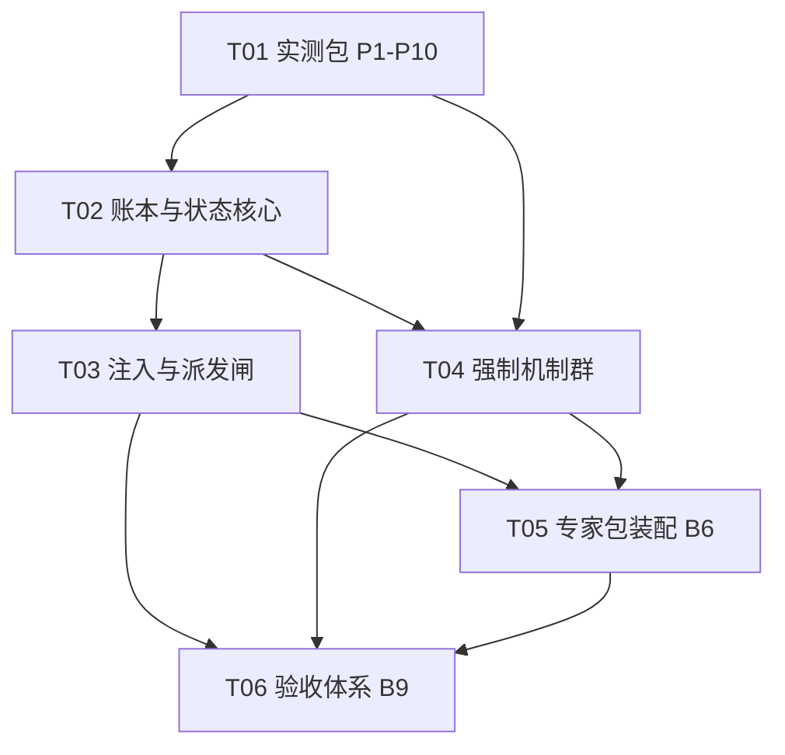

# SWB 分票包 · 最终版全文汇编（呈决策者审核版 v1）

- 汇编人：主理人（投递侧载体件——只汇编不改写，盘上 v1.1 终态各件全文逐字照录于后，原件未动一字）。
- 被汇编对象：架构席 arch-tk1 起草的 SWB 分票包七件（v1 `b086642` → 双席必改径直修 v1.1 `86be007` → TKT-3 轻修 `d72a854`＝本汇编所录终态）。
- 分票轮三方收口已成立（QA 席闭合核预授权放行 `a0fd121`／产品席认可放行 `50b3c8d`／起草方 TKT-3 修落 `d72a854`·主理人机械复核归零）。
- 本件生成时仓 HEAD：`d72a854`。

## 导读（主理人注·以下正文均为照录）

- 串行序：T01（能力实测·数据前置）→ T02 → (T03 ∥ T04) → T05 → T06；P 槽未验证能力零作任何票闸前提。
- 候裁点六项 Q-01…Q-06 见总览照录件「候裁」节，候决策者处置；决策者放行后方出工程师施工票。
- 计数断言（闭集 65＝13/11/7/10/13/11、映射表 9/12/16 行）三轮复跑不变，见总览照录件末节。

## 各件清单与哈希

| # | 件 | 原件路径 | 行数 | sha256 |
|---|---|---|---|---|
| 1 | 总览（三张映射表 · 候裁单列 · DAG · 计数断言） | `D:\multi-agent-collab-devkits\.collab\tickets\2026-11-01-SWB-ticket-pack-overview-v1.md` | 119 | `c0fc05c45382…` |
| 2 | T01 平台能力实测 P1–P10（全包唯一前置数据票） | `D:\multi-agent-collab-devkits\.collab\tickets\2026-11-01-SWB-T01-platform-capability-probes-p1-p10.md` | 58 | `04d84bb42f87…` |
| 3 | T02 账本·状态机·租约内核（B0/B1/B2） | `D:\multi-agent-collab-devkits\.collab\tickets\2026-11-01-SWB-T02-ledger-state-lease-core.md` | 74 | `0f50bf360434…` |
| 4 | T03 注入与串行闸·决策包（B3/B4） | `D:\multi-agent-collab-devkits\.collab\tickets\2026-11-01-SWB-T03-injection-dispatch-gate.md` | 59 | `af1ac1e20199…` |
| 5 | T04 强制钩子（B5/B7/B8/B10/B11） | `D:\multi-agent-collab-devkits\.collab\tickets\2026-11-01-SWB-T04-enforcement-hooks-b5-b7-b8-b10-b11.md` | 86 | `140de03a6f36…` |
| 6 | T05 专家包装配（B6） | `D:\multi-agent-collab-devkits\.collab\tickets\2026-11-01-SWB-T05-expert-pack-assembly-b6.md` | 76 | `7cc47702231c…` |
| 7 | T06 验收体系（B9） | `D:\multi-agent-collab-devkits\.collab\tickets\2026-11-01-SWB-T06-acceptance-system-b9.md` | 71 | `5297369cc972…` |

---

## 照录 1：总览（三张映射表 · 候裁单列 · DAG · 计数断言）

- 原件：D:\multi-agent-collab-devkits\.collab\tickets\2026-11-01-SWB-ticket-pack-overview-v1.md
- 行数 119 · sha256 `c0fc05c453828e511320c1dd1d6b9093996db9c8ba3bafc1394b94a60214bef6`

---

# SWB 分票包总览 v1（多席位协作系统·基线化后重立·架构席起草）

- 修订注记（append-only）：v1.1＝2026-11-01 双席必改四项径直修正落盘（N-QA-TKT-1／F-TKT-1：T01×3＋T03×1 处对不存在票号的幽灵引用改「T05」；N-QA-TKT-1 后半／F-TKT-2：T01 一处 `Q-05`→`Q-03`；F-TKT-3：T01 一处「（T04 产物）」→「（T03 产物）」；N-QA-TKT-2：本件违纪表行 4 承接列补「＋T02（state-transition 缺一拒迁）」）——映射表实质、闭集件数（65）、票数（6）零变动；v1 史不改。

- ANCHOR＝**08fc5ee**（本包起草时 `git rev-parse --short HEAD` 实测，工作仓 `D:\multi-agent-collab-devkits`，main）。
- 设计真源＝`.collab/refs/external/SWB-交接件v2.4-产品设计与架构设计-2026-11-01.md`（255 行·V7 行号前缀·sha256=45808c680344d225a0ca01918b8d528b5c66d80f42a93d154bae1d6ee3650589）。开工前实测两段落盘哈希：产品本体 L25–79＝`664ef6b2873e985db7cd29a1c55aa1c0a9dd9524f4f28eb70c6eb9d78fb6d419` ✅ 一致；架构本体 L80–237＝`e0801956f4f90e8331980d36d5bbc4b8d7c12ccbb25784d5443ceb620a68ea26` ✅ 一致（读数＝`sed -n '25,79p'|sha256sum`／`sed -n '80,237p'|sha256sum`）。
- 来历：两基线三方收口生效（主笔席宣布＋产品席/QA席认可放行零保留＝决策者拍板）。旧分票包 v1.0–v1.3 作废；本次＝按架构 §18 消费面声明（V7 L223）重立。分票＝架构席职责（决策者 2026-11-01 裁定，同 FUXI 案先例「票面由架构席起草，主理人只路由派工」）。
- 本包纪律声明：不引入交接件外新机制主张；全部票面引用可指认 V7 行号或 §号；[未验证:P槽] 条款一律未作任何票面闸前提（§10 规则镜像），相关处置全部单列候裁。

## 一、票清单（总数＝6）

| 票号 | 文件名 | 一句话标的 | 闭集件数（申报） |
|---|---|---|---|
| T01 | 2026-11-01-SWB-T01-platform-capability-probes-p1-p10.md | P1–P10 平台能力实测落盘（实测清单承接） | 13 |
| T02 | 2026-11-01-SWB-T02-ledger-state-lease-core.md | B0 账本＋B1 誊录＋B2 状态机/租约签发（租约段实例化）＋补登演示＋转正代写 | 11 |
| T03 | 2026-11-01-SWB-T03-injection-dispatch-gate.md | B3 注入构造/串行闸＋B4 决策包（注入面＋串行/派发承接） | 7 |
| T04 | 2026-11-01-SWB-T04-enforcement-hooks-b5-b7-b8-b10-b11.md | B5 写侧校验/提交审计＋B7 签名＋B8 重放＋B10 停刀＋B11 记忆中立化（写侧校验承接） | 10 |
| T05 | 2026-11-01-SWB-T05-expert-pack-assembly-b6.md | 专家包装配＝B6 职能并入票：席位卡装填＋§8 装配表＋变更通道路由（席位卡装填＋变更通道承接） | 13 |
| T06 | 2026-11-01-SWB-T06-acceptance-system-b9.md | 验收体系＝B9 职能并入票：验收双臂＋§13 触发判据成值＋六条演练（验收双臂＋触发判据承接） | 11 |

闭集件总数（申报）＝13+11+7+10+13+11＝**65**。

## 二、消费面声明九项 ↔ 票号映射表（行数＝9·审计对照基准）

| # | 消费面声明项（V7 L223 逐字） | 主承接票 | 次级承接 |
|---|---|---|---|
| 1 | 租约段实例化←表2-1 | T02（seat-permissions.json＋lease-issuer.py） | — |
| 2 | 写侧校验规则←表2-1不可写列＋提交审计 | T04（write-guard.py＋commit-audit.py＋deny_globs 消费） | T02（deny_globs 数据源埋设） |
| 3 | 席位卡装填←§5/§7 | T05（五卡＋§8 装配表逐行） | — |
| 4 | 注入面←表2-3 | T03（dispatch-spec.json 机械定义） | — |
| 5 | 串行/派发←表2-2/§4 | T03（serial-gate.py＋Agent ID 互验） | T06（drill-02 演练核验） |
| 6 | 实测清单←§10 | T01（P1–P10 逐号脚本） | — |
| 7 | 验收双臂←§16＋产品设计§4 | T06（三段式 CI 臂＋等效性抽检模板臂＋count-assert） | T05（无裸纪律装填面） |
| 8 | 变更通道←§12 | T05（lead 路由判定表五通道行） | T02（ticket-types.json 票型七类同源） |
| 9 | 触发判据←§13 | T06（thresholds.json＋metrics-gate.py） | T03（呈报触发源六码枚举） |

## 三、§9 十构件（B0–B11·缺 B6/B9）↔ 票号映射表（表体行数＝12＝B0–B11 编号全覆盖·实构件 10＋空缺编号 2 行＝显式并入声明·审计对照基准）

| 构件 | 施工票 | 形态 |
|---|---|---|
| B0 账本 | T02 | 直接（ledger-init.sh） |
| B1 誊录登记 | T02 | 直接（intake-register.py） |
| B2 状态机＋租约签发 | T02 | 直接（state-transition.py＋lease-issuer.py） |
| B3 注入构造＋串行闸 | T03 | 直接（dispatch-builder.py＋serial-gate.py） |
| B4 决策包装配 | T03 | 直接（decision-pack.py） |
| B5 写侧校验与提交审计 | T04 | 直接（write-guard/commit-audit/liveness-selfcheck） |
| B6 装配施工票 | T05 | **显式并入声明**（§9 编号空缺刻意·T05 票面背景节具名） |
| B7 签名 | T04 | 直接（sign-verify.py·fail-closed 无降级） |
| B8 影子重放 | T04 | 直接（shadow-replay.py） |
| B9 验收施工票 | T06 | **显式并入声明**（§9 编号空缺刻意·T06 票面背景节具名） |
| B10 停刀 | T04 | 直接（freeze-unfreeze.py） |
| B11 记忆中立化 | T04 | 直接（memory-neutralize.py） |

## 四、产品 §4 违纪模式闭集表（16 行）拦截面 ↔ 票号映射表（行数＝16·审计对照基准）

| 行 | 违纪模式（V7 L50–65 逐行） | 锚点（设计原载） | 拦截面承接票 |
|---|---|---|---|
| 1 | 流程状态存放于账本之外 | U6＋B11＋B1 | T02（B1）＋T04（B11） |
| 2 | 越租约路径写入 | U2＋B5 deny | T04 |
| 3 | 上游席位代写下游产出 | 红线②＋U4＋G4 | T05（卡纪律行＋lead 卡红线摘要） |
| 4 | 跳过环节或签字集合缺一即通过 | 表2-3＋B3 串行闸 | T03（签字集合校验＋serial-gate）＋T02（state-transition 缺一拒迁） |
| 5 | 状态变更绕过脚本直改账本 | U5＋B2 日志互验 | T02（state-transition 唯一入口） |
| 6 | 检索自救替代注入自足 | U7＋P3[未验证]＋G5 | T04（B11 读侧出面·不声明能力面保证） |
| 7 | 无票提交/amend/rebase | B5 提交审计＋日终对账 | T04（commit-audit）＋T02（reconcile-daily） |
| 8 | 裸纪律入卡 | "无裸纪律"验收（§7） | T05（装面带标注）＋T06（count-assert 模式2） |
| 9 | 未验证能力被闸引为前提 | §10 规则＋四态标注 | T01（读数先行）＋全包票面纪律（总览声明节） |
| 10 | 计数/数字声明失实 | 制度④计数即断言 | T06（count-assert 模式1/3） |
| 11 | 过程件被用作引用目标 | 制度②过程引用只可消除 | T04（shadow-replay 引用扫描＋memory-neutralize 引用扫描） |
| 12 | 生成方自判合格性 | 制度③状态申报制 | T06（结论权归 QA/CI 面·票面禁自判条款） |
| 13 | 降级态无人承接 | §14 承接表具名 | T06（抽检记录面）＋T01（QA 复核栏）＋T04（退路承接注记） |
| 14 | 停刀延迟超阈 | B10＋deny−freeze≤60s | T04（freeze 自计时）＋T06（成值 60 入 thresholds） |
| 15 | 派发身份不符/注入包超集/串行被破 | Agent ID 互验＋B3 白名单＋串行闸 | T03 |
| 16 | 审查注入面自选/灰度现场裁量 | dispatch-spec 机械定义＋B4 机械门禁 | T03（decision-pack 灰度门禁） |

## 五、票间依赖 DAG 与串行序

- 严格串行链：T01→T02→（T03/T04）→T05→T06。
- 逻辑可并行对：**T03 ∥ T04**（互不消费对方闭集文件；T03 只依赖 T02 数据源，T04 依赖 T01+T02）。
- 派工运行态＝架构表2-2（V7 L112）串行执行纪律：一票一新鲜实例、票间串行、一票活跃；**在 B3 串行闸（T03 产物）自身上线之前，票间串行由人类侧派工纪律保证**（主理人只路由派工）——此为时序自举注记，非新机制。
- 每票 commit 单独笔，`collab:` 前缀只含本票闭集件。

## 六、候裁点清单（单列·不自行拍·行数＝6）

| # | 候裁点 | 所在票 | 设计依据 |
|---|---|---|---|
| Q-01 | 交付根路径实例化：设计真源以专家包相对路径表述，落盘本仓顶层根名（暂按 `software-team/`）属落盘约定 | T05 | §8 装配表相对路径无仓根规定 |
| Q-02 | P7 读数阴性→B0 退路三重保证中异地镜像承载细节 | T02 | §9 B0 退路＋§11 承载者＝人类侧 |
| Q-03 | `.mcp.json` 三 server 装配与否随 P8 求证（P8＝问句无预设）；P8 未出前不装配 | T05 | §8 行6 [未验证:P8] |
| Q-04 | P4 运行时阴性→SubagentStart 状态文件退路启用与否（人类拍板启用） | T04 | §9 B5 退路逐字 |
| Q-05 | P6 读数阴性→B10 退路「逐席显式 deny 列表」启用与否 | T04 | §9 B10 退路逐字 |
| Q-06 | disallowedTools 装填条件＝P3 实测 pass；未过缺省不装配 | T05 | §8 行3 [未验证:P3] |

## 七、计数即断言（制度④·自数＋交叉验）

- 申报：票总数＝6；各票闭集件数＝13/11/7/10/13/11；闭集总件数＝65；映射表行数＝9＋12＋16＋6＝43（构件表 12 行＝B0–B11 编号全覆盖，实构件 10＋并入声明 2）。
- 完工实测读数（落盘后本机实测，附于回执）：
  1. 票文件数：`ls agent-experts/baigong-software-team/.scratch/tickets/2026-11-01-SWB-T*.md | wc -l` ＝6；
  2. 各票锚行下条目行计数：对每票 `- 声明闭集：` 锚行后连续裸 `- ` 路径行计数＝13/11/7/10/13/11（与票面申报数逐一相等）；
  3. 总览映射表行数：消费面表体行数＝9、构件表体行数＝12（B0–B11 编号全覆盖）、违纪表体行数＝16、候裁表体行数＝6（与反查基准一致，无空项）；
  4. 文件名 kebab 正则：`ls agent-experts/baigong-software-team/.scratch/tickets/2026-11-01-SWB-*.md | grep -cE '^\.scratch/tickets/2026-11-01-SWB-(T[0-9]{2}-)?[a-z0-9]+(-[a-z0-9]+)*\.md$'` ＝7（6 票＋1 总览；全部通过，零命中大写/下划线/非 ASCII）。
- 交叉验第二实现＝T06 交付后由其 count-assert.py 模式1/3 重跑同一断言（本包阶段以 shell 计数为第一实现）。

## 八、禁动面（全包统一·各票票面另列个体面）

- 两基线登记件本体（V7 文件全域）零触碰；`.collab/` 过程域仅各票回执文件一处新增加入（回执落 `.collab/receipts/`），其余零触碰；`docs/`、既有交付面（deliverables/、tools/、workbuddy/、README、.gitignore）零触碰；各票彼此声明闭集文件互不可写。
- 本总览与六票本身＝本任务唯一新增面（`.scratch/tickets/` 内 7 件新文件）。

## 照录 2：T01 平台能力实测 P1–P10（全包唯一前置数据票）

- 原件：D:\multi-agent-collab-devkits\.collab\tickets\2026-11-01-SWB-T01-platform-capability-probes-p1-p10.md
- 行数 58 · sha256 `04d84bb42f879513488c655a7874d180aa9473213e50dce87bcdadc593b661cb`

---

# SWB-T01 平台能力实测包 P1–P10（施工票·L3·架构席起草）

- 开端读数：ANCHOR＝08fc5ee（分票包基线化实测，见总览件）；本票开工时实测 `git rev-parse --short HEAD` 附回执。
- 设计真源：`.collab/refs/external/SWB-交接件v2.4-产品设计与架构设计-2026-11-01.md`（行号前缀 V7；产品本体 L25–79 sha256=664ef6b2…；架构本体 L80–237 sha256=e0801956…）。逐字引用以该件为准，票面转述仅作路由。
- 背景（自包含）：多席位协作系统两份基线（产品设计 v2.4＋架构设计 v2.4）已三方收口生效。架构 §10 登记平台验证清单 P1–P10，并令「P3/P4/P7 由实测票先行落盘；P4/P7 阻塞 B5/B0 定型；未验证能力不得被任何闸引为前提」。本票＝消费面声明第⑥项「实测清单←§10」的承接票，也是全包唯一前置数据票：其读数决定 T02 主路形态、T05 主路形态、T05 候裁面处置。**§10 规则镜像到票面纪律：本包任何票面不得以 [未验证:P槽] 能力作闸前提。**
- 前置票：无（基线生效＝开工前提，架构 §18 基线化时序：B0 开工在基线生效之后；本票先于 B0 属 §10「实测先行」授权）。
- 逻辑并行性：可与任何票并行；实际派工在 B3 串行闸（T03 产物）上线前由人类侧纪律保证一票活跃，建议按 DAG 序首位施工。

## 声明闭集（13 件·本票唯一可写面）
- 声明闭集：
- software-team/tests/probes/run-probes.sh
- software-team/tests/probes/p1-cross-seat-shared-state.sh
- software-team/tests/probes/p2-lead-md-injection.sh
- software-team/tests/probes/p3-tools-declaration-scope.sh
- software-team/tests/probes/p4-pretooluse-stdin-fields.sh
- software-team/tests/probes/p5-event-concurrency-timing.sh
- software-team/tests/probes/p6-deny-cross-seat-consistency.sh
- software-team/tests/probes/p7-git-standalone-service.sh
- software-team/tests/probes/p8-mcp-auth-shape.sh
- software-team/tests/probes/p9-dispatch-record-export.sh
- software-team/tests/probes/p10-thirdparty-hooks-parity.sh
- software-team/tests/probes/results/probe-results.json
- software-team/tests/probes/results/probe-report.md

## 逐条施工规格

### T01-A 十个实测脚本（P1–P10 逐号一件·V7 L183 词条逐号对应）
每个脚本头部注 `# P<n> <§10 原句摘录>`，落点路径见闭集行。逐号标的（§10 原文口径，不得扩义）：
- p1＝席位间文件外共享状态；p2＝主理人 md 注入恒常性与上限；p3＝工具声明生效范围；p4＝PreToolUse stdin 字段完整性（代码层已证、待运行时——运行时部分为本票增量）；p5＝事件并发时序；p6＝deny 跨席位一致性；p7＝git 独立服务可建性；p8＝MCP auth 形态（**问句，无预设**：只登记观测，不得预填结论）；p9＝派发记录导出；p10＝第三方插件 hooks 同权性。
- p4 代码层复真锚点（§19 buildAgentTrigger 行）：对平台 CLI 打包件 `codebuddy-lite-wb.mjs` grep `executePreToolUseHooks` payload 注入 `agent_id`/`agent_type`，脚本须复现该 grep 并附读数；运行时核验＝实际触发一次 PreToolUse 并回显 stdin JSON 字段清单。
- p7 核验方式＝按 §19「git 原生能力」行：仅验**可建性**（本地建裸仓＋保护分支/拒非快进配置可达），不验远端服务运维（属 §11 人类侧外置物）。

### T01-B 读数落盘（机检源）
- `probe-results.json`：顶层对象，键＝P1–P10 恰十个；每键值＝`{"status":"pass|negative|inconclusive","evidence":"<读数文件路径或命令>","ts":"<ISO8601>"}`。status 三态闭集，禁他值。
- `run-probes.sh`：依序调用十脚本→汇总写 probe-results.json→退出码：全十键齐且值合法＝0，否则≠0。
- `probe-report.md`：十节（每 P 一节），每节含实测命令、读数摘录、QA 复核结论栏（QA 席填写，工程师只留空栏——§14 行2「装配工程师实测＋QA 复核」）。

## 验收判据（全部机械可判）
1. `bash software-team/tests/probes/run-probes.sh; echo $?` ＝0；
2. `python -c "import json;d=json.load(open('software-team/tests/probes/results/probe-results.json'));assert sorted(d)==['P'+str(i) for i in range(1,11)];assert all(v['status'] in ('pass','negative','inconclusive') for v in d.values())"` 退出 0；
3. `ls software-team/tests/probes/*.sh | wc -l` ＝11（十实测＋runner）；
4. p4 脚本回执含 `executePreToolUseHooks` grep 命中读数与 stdin 字段回显两块证据（回执内嵌原文，grep 可定位）；
5. probe-report.md 节数：`grep -c '^## P' software-team/tests/probes/results/probe-report.md` ＝10；
6. P8 节结论栏只含观测不含预设：人工抽检项移交 QA（不机械化，因 §10「问句，无预设」）。

## 票间关系
- 后置消费：T02 读 P7 定主路；T05 读 P4/P5 定主路；T05 读 P3 定 disallowedTools 候裁；P8 读数供候裁单列 Q-03。
- 本票不依赖任何票。

## 禁动面（零触碰）
- 两基线登记件（V7 文件本体）、`.collab/` 全域（回执除外）、`docs/`、其余各票声明闭集文件、`software-team/` 下非本票闭集路径（目录首建者以先开工票为准，见总览 Q-01）。
- 工程师不得改本票票体四字段（§7 工程师席位纪律）。

## 候裁点（单列·不自行拍）
- 无（本票只产读数；读数触发的拍点列于 T02/T05 票面与总览候裁清单）。

## 回执
落 `.collab/receipts/2026-11-01-SWB-T01-receipt.md`：开端 HEAD＋完整文件清单（与 commit name-only 全等）＋全部机制断言附实测载体。commit 单独笔，`collab:` 前缀只含本票闭集件。

## 照录 3：T02 账本·状态机·租约内核（B0/B1/B2）

- 原件：D:\multi-agent-collab-devkits\.collab\tickets\2026-11-01-SWB-T02-ledger-state-lease-core.md
- 行数 74 · sha256 `0f50bf36043485b10424ca1983bb4fa4edb0fe3cf9b5fd3597fc974ae45e4ad3`

---

# SWB-T02 账本与状态核心：B0＋B1＋B2（含租约段实例化）（施工票·L3·架构席起草）

- 开端读数：ANCHOR＝08fc5ee（见总览件）；开工时实测 HEAD 附回执。
- 设计真源：`.collab/refs/external/SWB-交接件v2.4-产品设计与架构设计-2026-11-01.md`（V7；产品 L25–79 sha256=664ef6b2…；架构 L80–237 sha256=e0801956…）。
- 背景（自包含）：承接消费面声明第①项「租约段实例化←表2-1」（V7 L223）。覆盖构件：B0 账本、B1 誊录登记、B2 状态机＋租约签发（§9 V7 L168–181）。时序：基线已生效，B0 开工合规（§18 基线化时序 V7 L225）；§18 补登条款（V7 L224）令「B0 施工票验收含'补登演示'并互引本条款」——落为本票验收判据 A6。租约＝{票ID·路径集·席位ID·哈希}（§17）；租约段经架构签注由 B2 从表2-1（V7 L94）实例化。账本六类记录＝派发/写入/签字/注入包哈希/intake 登记/呈报（§3）。
- 前置票：T01（P7 读数决定 B0 主路/退路形态；§9 B0 行「P7 阴性→本地裸仓＋PreToolUse 拦 force-push/amend＋异地镜像＋日终对账」）。P7 阴性时按候裁 Q-02 呈人类拍板后择路，不自行定。

## 声明闭集（11 件·本票唯一可写面）
- 声明闭集：
- software-team/skills/sop/scripts/ledger-init.sh
- software-team/skills/sop/scripts/intake-register.py
- software-team/skills/sop/scripts/state-transition.py
- software-team/skills/sop/scripts/lease-issuer.py
- software-team/skills/sop/scripts/reconcile-daily.py
- software-team/skills/sop/scripts/baseline-backfill-demo.py
- software-team/skills/sop/scripts/promote-manifest.py
- software-team/config/seat-permissions.json
- software-team/config/ticket-types.json
- software-team/tests/s2/test_ledger_core.py
- software-team/tests/s2/test_lease_instantiation.py

## 逐条施工规格

### T02-A ledger-init.sh（B0 主路/退路双形）
- 主路（P7 pass）：独立 git 服务初始化＝远端裸仓＋拒非快进（`receive.denyNonFastForwards=true`）＋拒强制推送（`receive.denyDeletes=true`）＋保护分支配置；退路（P7 negative）：本地裸仓＋输出「三重保证待 T04 hooks 与异地镜像＋日终对账补位」声明行（PreToolUse 拦截实体在 T04，本脚本只留配置锚）。
- 主信任锚＝git 原生哈希链（§3/§17）；记录级前向哈希字段 `prev_hash` 仅供单记录独立校验。

### T02-B intake-register.py（B1）
- 输入：人类输入原文件路径；输出：intake 登记记录（六类记录之「intake 登记」）入账＋登记号回显。
- 闭集六类誊录类型（表2-2「人类输入誊录与路由…B1 六类闭集，不做业务解析」）；脚本零裁量：不做任何业务解析，只登记与编号。

### T02-C state-transition.py（B2 状态迁移/登记/记账）
- 状态集＝节点 1 需求→2 设计→3 拆票→4 执行→5 发布→6 灰度（§4）＋挂起态（§17）；迁移合法性表硬编码，非法迁移 exit≠0。
- 每次迁移写「派发/签字/呈报」对应记录类；签字集合按表2-3（V7 L119）六节点签字行校验，缺一拒迁并写「呈报」类审计事件（触发源六闭集见 §4/§13）。
- timeouts 缺省读取：工程师票 48h／呈报 24h（§13），未配置项＝不适用。

### T02-D lease-issuer.py（B2 租约签发·消费面①落点）
- 实例化源＝`config/seat-permissions.json` 逐席位行，行集＝表2-1（V7 L94–103）六席位行逐行转录：写域/可写内容/**明确不可写**三列＋载体列标注；「明确不可写」列另出 `deny_globs` 数组供 T04 B5 消费（消费面②的数据源在本票埋设，校验实体在 T04）。
- 签发输出＝`{ticket_id, path_globs, seat_id, hash}` 四字段 JSON 入账（§9 B2 行/§17 租约词条）；架构签注字段 `countersign` 必填（§7 架构纪律「租约签注唯一生产权」）。
- `config/seat-permissions.json` 头部注 `derived_from: 表2-1`；`config/ticket-types.json`＝票型七类闭集（产品需求/开发/缺陷/部署/规则/流程变更/验收，§3）＋修票权映射（表注「修票权＝票类作者权」五映射）。同源声明：本两文件与 T03 dispatch-spec、T05 ticket-authors 同一票类清单派生（§3），同源校验断言在 T03 验收。

### T02-E reconcile-daily.py（日终对账）
- 对账对象＝账本六类记录 vs git 提交/租约台账交叉核；差≠0 → 写「呈报」类审计事件（触发源「对账差≠0」）。

### T02-F baseline-backfill-demo.py（补登演示·§18 互引条款）
- 演示动作＝向账本追加两条基线条目：产品设计 v2.4（sha256=664ef6b2…，行数 55＝L25–79 段实测）＋架构设计 v2.4（sha256=e0801956…，行数 158＝L80–237 段实测）；哈希引用落盘哈希非转录；append-only（只追加不回改）。
- 脚本头注互引：`clause: 架构v2.4 §18 补登条款（V7 L224）`。

### T02-G promote-manifest.py（转正代写·表2-1 主理人行/表注 V7 L103 落点）
- 实现表注定义：状态机脚本将验证通过的草稿按 `manifest` 清单文件声明复制入 `docs/` 并附来源哈希——唯一合法写入形态；代写主体＝本脚本（非任何 LLM 席位）。
- manifest 文件由账本域保管（表2-1 主理人可写域）；脚本校验草稿哈希＝manifest 声明哈希后方复制，不符 exit≠0。

## 验收判据（全部机械可判）
1. `bash software-team/skills/sop/scripts/ledger-init.sh && echo INIT_OK` 输出含 `INIT_OK` 且非快进/保护分支配置读数回显；
2. `python -c "import json;d=json.load(open('software-team/config/seat-permissions.json'));assert len(d['seats'])==6"` 退出 0（六席位行＝表2-1 行数）；
3. `python -c "import json;t=json.load(open('software-team/config/ticket-types.json'));assert len(t['types'])==7"` 退出 0（票型七类）；
4. lease-issuer 冒烟：签一张样例租约，`python` 断言输出四键恰为 `ticket_id,path_globs,seat_id,hash`；重复签发未签注件 exit≠0；
5. `python software-team/tests/s2/test_ledger_core.py software-team/tests/s2/test_lease_instantiation.py` 退出 0（工程师写脚本、CI 机械执行、QA 出结论——三段式，本票回执只附执行读数）；
6. `python software-team/skills/sop/scripts/baseline-backfill-demo.py` 退出 0，账本中两基线条目哈希与登记件实测值逐字等（回执附两读数）；
7. 非法迁移冒烟：state-transition 对「4 执行→1 需求」请求 exit≠0 且产生「呈报」类记录一条（读数入回执）；
8. promote-manifest 冒烟：样例草稿哈希与 manifest 声明一致→复制入 `docs/` 成功并附来源哈希读数；篡改样例→exit≠0 且 `docs/` 无新增（两读数）。

## 票间关系
- 前置：T01（P7）。后置：T03（消费账本记录类＋seat-permissions 同源）、T04（消费 `deny_globs`＋租约台账）、T05（席位卡脚本调用清单引用本票实体名）。

## 禁动面（零触碰）
- 两基线登记件本体、`.collab/` 全域（回执除外）、`docs/`、`software-team/` 下非本票闭集路径、T01/T03/T04/T05 声明闭集全部文件。
- 工程师不得改本票票体四字段；账本历史 append-only 不回改。

## 候裁点（单列·不自行拍）
- Q-02：P7 读数阴性时 B0 退路三重保证的异地镜像承载方与凭证保管细节（§11 已定承载者＝人类侧，配置细节呈人类）。

## 回执
落 `.collab/receipts/2026-11-01-SWB-T02-receipt.md`：开端 HEAD＋完整文件清单（与 commit name-only 全等）＋判据 1–8 全部实测读数。commit 单独笔，`collab:` 前缀只含本票闭集件。

## 照录 4：T03 注入与串行闸·决策包（B3/B4）

- 原件：D:\multi-agent-collab-devkits\.collab\tickets\2026-11-01-SWB-T03-injection-dispatch-gate.md
- 行数 59 · sha256 `af1ac1e201992bb7f3335e942358dab745b396bb004ada9552cb6853cc790512`

---

# SWB-T03 注入构造与派发闸：B3＋B4（注入面＋串行/派发）（施工票·L3·架构席起草）

- 开端读数：ANCHOR＝08fc5ee（见总览件）；开工时实测 HEAD 附回执。
- 设计真源：`.collab/refs/external/SWB-交接件v2.4-产品设计与架构设计-2026-11-01.md`（V7；产品 L25–79 sha256=664ef6b2…；架构 L80–237 sha256=e0801956…）。
- 背景（自包含）：承接消费面声明第④项「注入面←表2-3」（V7 L223，表体 V7 L119–128）与第⑤项「串行/派发←表2-2/§4」（表体 V7 L104–118，§4 节位 V7 L131–132）。覆盖构件：B3 注入构造＋串行闸、B4 决策包装配（§9 V7 L168–181）。违纪模式表行 4「跳过环节或签字集合缺一即通过→表2-3＋B3 串行闸」、行 15「派发身份不符/注入包超集/串行被破→Agent ID 互验＋B3 白名单＋串行闸」、行 16「审查注入面自选/灰度现场裁量→dispatch-spec 机械定义＋B4 机械门禁」（产品 §4 V7 L47–65）的拦截面主承接在本票。
- 前置票：T02（账本记录类、seat-permissions/ticket-types 同源件）。

## 声明闭集（7 件·本票唯一可写面）
- 声明闭集：
- software-team/skills/sop/scripts/dispatch-builder.py
- software-team/skills/sop/scripts/serial-gate.py
- software-team/skills/sop/scripts/decision-pack.py
- software-team/config/dispatch-spec.json
- software-team/config/ticket-authors.json
- software-team/tests/s3/test_dispatch_gate.py
- software-team/tests/s3/test_decision_pack.py

## 逐条施工规格

### T03-A dispatch-spec.json（审查注入面机械定义·消费面④落点）
- 行集＝表2-3（V7 L119–128）六节点行逐行转录：节点号、签字集合（逐项名）、人类角色列；每节点附「审查注入面」数组＝机械列明该节点审查者所见件集（§2 表注 V7 L128：「QA 审计切片显式列明；产品含已登记 intake 只读＋架构触发项命中件草稿态；工程师只见本票＋上游内容副本。审查者看什么由 dispatch-spec 机械定义，不许自选」）。
- 头部注 `derived_from: 表2-3`；票类清单引用 ticket-types.json 同源（§3 同源校验）。

### T03-B dispatch-builder.py（B3 注入构造·机械展开）
- 输入票 ID → 按 dispatch-spec 机械展开注入包（禁手拼路径）；注入包哈希写账本「注入包哈希」记录类（§3 六类）。
- 白名单超集检测：展开结果 ⊖ spec 声明面 ≠ ∅ → exit≠0（违纪行 15「注入包超集」拦截）。
- Agent ID 互验键双向比对（§8 派发约定 V7 L167：「name 传 Agent ID 禁中文名；互验键双向比对；同源四方」）；不符 → 计差异（口径 §13：分子｛Agent ID 不符∨包哈希不符∨白名单超集｝）。

### T03-C serial-gate.py（B3 串行闸·消费面⑤落点）
- 规则＝§4（V7 L131–132）「执行期全系统一票活跃，新派发被串行闸拒绝」；§9 B3 行「活跃票非零拒绝派发」；表2-2（V7 L112）「票内工作：工程师，一票一新鲜实例，票间串行」。
- 读数源＝账本活跃票计数；活跃≠0 时任何派发请求 exit≠0 且写「呈报」类审计事件。

### T03-D decision-pack.py（B4 决策包装配）
- 机械计算＋异常强制呈报：触发源六闭集｛租约越界 deny／对账差≠0／活性自检失败／引用扫描命中／超期／熔断｝（§4 V7 L132）逐码实现为呈报触发枚举；主理人仅投递（表2-2 V7 L111）。
- 灰度→全量机械门禁（表2-2 V7 L117「QA 按声明判据机械门禁，不得现场裁量」）：判据读取＝票内声明字段，脚本比对读数，不符拒出 full-rollout 决策包。

### T03-E ticket-authors.json（修票权映射·与 T02 同源）
- 转录表注（V7 L103）五映射：开发票→架构修｜缺陷票→QA 修｜部署票三字段→工程师部署域重写｜生产票目标字段→状态机依放行记录机械派生｜规则票→提案席位；票类清单∈ticket-types.json 同一集合。

## 验收判据（全部机械可判）
1. `python -c "import json;d=json.load(open('software-team/config/dispatch-spec.json'));assert len(d['nodes'])==6;assert all(len(n['signoffs'])>0 for n in d['nodes'])"` 退出 0（六节点签字集合非空）；
2. 同源断言：`python -c "import json;a=set(x['id'] for x in json.load(open('software-team/config/ticket-types.json'))['types']);b=set(json.load(open('software-team/config/ticket-authors.json'))['authors']);assert a==b"` 退出 0；
3. 串行闸冒烟：账本预置 1 张活跃票后调 dispatch-builder → exit≠0 且账本新增「呈报」记录恰 1 条（读数入回执）；
4. 超集冒烟：样例票注入面超出 spec 声明 → dispatch-builder exit≠0，回显差异集；
5. `python software-team/tests/s3/test_dispatch_gate.py software-team/tests/s3/test_decision_pack.py` 退出 0；
6. 触发源六码枚举齐备：`grep -c 'TRIG_' software-team/skills/sop/scripts/decision-pack.py` ≥6 且六码名与 §4 六项一一对应（回执附 grep 读数对照表）。

## 票间关系
- 前置：T02。后置：T04（B5 拦 force-push 时经账本活跃票口径）、T06（六条演练中「派发-执行-回流」链消费 B3/B4）、T05（席位卡「脚本调用点」行引用本票实体名）。

## 禁动面（零触碰）
- 两基线登记件本体、`.collab/` 全域（回执除外）、`docs/`、T01/T02/T04/T05/T06 声明闭集全部文件。
- 工程师不得改本票票体四字段。

## 候裁点（单列·不自行拍）
- 无新增。派发记录导出形态若涉 P9 读数依赖，属观测项不属闸前提（§10 规则）。

## 回执
落 `.collab/receipts/2026-11-01-SWB-T03-receipt.md`：开端 HEAD＋完整文件清单＋判据 1–6 实测读数。commit 单独笔，`collab:` 前缀只含本票闭集件。

## 照录 5：T04 强制钩子（B5/B7/B8/B10/B11）

- 原件：D:\multi-agent-collab-devkits\.collab\tickets\2026-11-01-SWB-T04-enforcement-hooks-b5-b7-b8-b10-b11.md
- 行数 86 · sha256 `140de03a6f36e83d29c56c99b97a96f1310a9864fea823a4efdc5b19557d4537`

---

# SWB-T04 强制机制群：B5＋B7＋B8＋B10＋B11（写侧校验与提交审计等）（施工票·L3·架构席起草）

- 开端读数：ANCHOR＝08fc5ee（见总览件）；开工时实测 HEAD 附回执。
- 设计真源：`.collab/refs/external/SWB-交接件v2.4-产品设计与架构设计-2026-11-01.md`（V7；产品 L25–79 sha256=664ef6b2…；架构 L80–237 sha256=e0801956…）。
- 背景（自包含）：承接消费面声明第②项「写侧校验规则←表2-1 不可写列＋提交审计」（V7 L223；不可写列 V7 L94–103）。覆盖构件：B5 写侧校验与提交审计、B7 签名、B8 影子重放、B10 停刀、B11 记忆中立化（§9 V7 L168–181）。违纪模式表拦截面承接：行 2「越租约路径写入→U2＋B5 deny」、行 5「绕过脚本直改账本→U5＋B2 日志互验」（B5 面）、行 6「检索自救→U7＋B11 读侧扫描（P3 能力面未验证，只作辅助面不作假设）」、行 7「无票提交/amend/rebase→B5 提交审计＋日终对账」、行 11「过程件被用作引用目标→B8 引用可达性扫描＋B11 下游件引用扫描」、行 14「停刀延迟超阈→B10＋deny−freeze≤60s」。**票面纪律镜像 §10：B5 主路以 P4 读数为准，P4 运行时未过前不得把 stdin 完整性当已成立闸前提——主路/退路双形并列，择路由候裁 Q-04。**
- 前置票：T01（P4/P5/P6 读数）、T02（租约台账＋`deny_globs` 数据源＋账本记录类）。

## 声明闭集（10 件·本票唯一可写面）
- 声明闭集：
- software-team/hooks/hooks.json
- software-team/skills/sop/scripts/write-guard.py
- software-team/skills/sop/scripts/commit-audit.py
- software-team/skills/sop/scripts/liveness-selfcheck.py
- software-team/skills/sop/scripts/freeze-unfreeze.py
- software-team/skills/sop/scripts/memory-neutralize.py
- software-team/skills/sop/scripts/shadow-replay.py
- software-team/skills/sop/scripts/sign-verify.py
- software-team/config/seat-permissions-hooks-map.json
- software-team/tests/s4/test_enforcement.py

## 逐条施工规格

### T04-A hooks.json（平台事件强制·§5 工件矩阵 V7 L133–141）
- PreToolUse matcher：写类工具 → `write-guard.py`；Read/Grep matcher → `memory-neutralize.py`（§9 B11 行）。
- PostToolUse：记账 → `commit-audit.py`（§9 B5 行「PostToolUse 记账＋对账＋活性自检」）。
- 拦截规则不装业务逻辑（§5「不装什么」列）。
- 决策词表锚点（§19 V7 L234）：`permissionDecision` 取 deny/ask；exit 2→blocking；本文件只用该词表既有值，不自造。

### T04-B write-guard.py（B5 写侧校验·消费面②落点）
- 主路（P4 运行时 pass）：PreToolUse stdin 直读 `agent_id`/`agent_type` → 查租约台账（T02 lease 记录）→ 路径 ∉ 租约 path_globs ∨ 路径 ∈ `seat-permissions-hooks-map.json` 的 deny_globs（源＝表2-1「明确不可写」列逐席位转录）→ `permissionDecision: deny`（U2/G1）。
- 退路（P4 运行时 negative）：SubagentStart 状态文件形态（§9 B5 行「P4 阴性→SubagentStart 状态文件，人类拍板启用」）——实现同判据、身份源换为状态文件；启用与否候裁 Q-04，票面两形同交付、缺省不启用退路。
- 每次 deny 写「写入」记录＋触发「租约越界 deny」呈报码（§4 触发源六闭集第一项）。

### T04-C commit-audit.py（B5 提交审计）
- 拦三形态：amend／rebase／orphan 提交（无票 ID trailer，§17 词条）→ exit 2 blocking；
- B0 退路补位：P7 阴性时拦 force-push（§9 B0 退路「PreToolUse 拦 force-push/amend」）；
- PostToolUse 记账：提交哈希/票 ID/席位归因入「写入」记录类。

### T04-D liveness-selfcheck.py（B5 活性自检）
- 形态＝§17「先注入必中事件再读统计」：注入一条哨兵 deny 请求→断言统计计数+1→失败写「活性自检失败」呈报码（§13 指标异常闭集第二项）。

### T04-E freeze-unfreeze.py（B10 停刀）
- 动作链＝§9 B10 行逐字：freeze 清租约 → 全写 matcher 置 deny → 终止实例；解冻/吊销仅人类直通触点触发（表2-2 V7 L118「脚本不得自触发」——脚本无自动触发路径，入口带人类令牌校验）。
- 成值时限（§13 V7 L198）：deny−freeze ≤ **60s**（缺省，可配但缺省即 60）；P6 阴性时按退路「逐席显式 deny 列表」实现配置面（启用候裁 Q-05 随 P6 读数）。
- 一键冻结＝紧急直通三通道之首（§4/§17）。

### T04-F memory-neutralize.py（B11 记忆中立化）
- 两面扫描（§9 B11 行）：①Read/Grep matcher 扫描记忆文件读取→引用记忆作流程状态即拦/标；②下游件引用扫描：新增/修改件文本出现记忆文件路径引用→报「引用扫描命中」呈报码（§4 触发源第四项）。
- 对应 U6/G1-G2、违纪行 1（B11 面）。诚实边界：U7 保证＝「P3[未验证]＋G5 辅助面」（§7 V7 L154）——本脚本只实现读侧检出面，不声明阻断性能力面保证。

### T04-G shadow-replay.py（B8 影子重放）
- 输入＝ledger＋archive＋注入存档（§9 B8 行）；输出＝差异三分类记录＋引用可达性扫描结论（过程件被引用即命中，违纪行 11）。
- 失效＝重实现（不涉平台依赖）。

### T04-H sign-verify.py（B7 签名·fail-closed）
- gpg 验签封装：签名件（`human/reviews/` 形态）验签＋身份锚比对；**刻意无降级**（§9 B7 行）：gpg 不可用→exit≠0 硬失败，禁 fallback。
- 密钥生成/保管＝人类离线自持动作（§11 密钥根行），不在票内；票内只交付验证侧脚本与验签记录入账。

### T04-I seat-permissions-hooks-map.json
- 由 T02 `seat-permissions.json` 派生 `deny_globs` 的 hooks 消费形态（表2-1「明确不可写」列）；头部注 `derived_from: seat-permissions.json (表2-1)`；与源件一致性断言在测试内。

## 验收判据（全部机械可判）
1. `python -c "import json;h=json.load(open('software-team/hooks/hooks.json'));assert h"` 退出 0 且文件含 PreToolUse/PostToolUse 两键（grep 读数）；
2. deny 冒烟：无租约状态下样例写请求经 write-guard → 输出含 `"permissionDecision":"deny"`（读数入回执）；
3. orphan 提交冒烟：构造无票 trailer 样例提交描述 → commit-audit exit＝2；amend/rebase 样例各 exit＝2（三读数）；
4. `python software-team/skills/sop/scripts/liveness-selfcheck.py` 退出 0 且账本「呈报」类无「活性自检失败」新增；停用 hooks 后重跑 → exit≠0 且新增该呈报码恰 1 条（双向读数，§17 活性自检定义的正反两态）；
5. freeze 冒烟：触发 freeze → 断言链「租约清空→全写 deny→实例终止」三步读数齐且耗时 ≤60s（脚本自计时回显）；
6. B11 冒烟：样例下游件含记忆路径引用 → memory-neutralize 命中码回显；
7. sign-verify 对伪造签名 exit≠0、对 gpg 缺失环境 exit≠0（fail-closed 两读数）；
8. `python software-team/tests/s4/test_enforcement.py` 退出 0；
9. 派生一致性断言：seat-permissions-hooks-map.json 的 deny_globs 席位集 ⊆ seat-permissions.json 席位集且每席位非空（测试内断言，读数入回执）。

## 票间关系
- 前置：T01、T02。后置：T05（席位卡脚本调用清单引用本票实体名；六条演练「写侧拦截／停刀-恢复／重放对账」三链消费本票产物）。

## 禁动面（零触碰）
- 两基线登记件本体、`.collab/` 全域（回执除外）、`docs/`、T01/T02/T03/T05 声明闭集全部文件。
- B0 账本历史 append-only 不回改；工程师不得改本票票体四字段。

## 候裁点（单列·不自行拍）
- Q-04：P4 运行时读数阴性 → SubagentStart 状态文件退路是否启用（§9 B5 行明示「人类拍板启用」）。
- Q-05：P6 读数阴性 → B10 退路「逐席显式 deny 列表」启用（§9 B10 行）。
- B7 密钥根生成/轮换属人类侧密钥自持动作，票面不代拍（§11）。

## 回执
落 `.collab/receipts/2026-11-01-SWB-T04-receipt.md`：开端 HEAD＋完整文件清单＋判据 1–9 实测读数。commit 单独笔，`collab:` 前缀只含本票闭集件。

## 照录 6：T05 专家包装配（B6）

- 原件：D:\multi-agent-collab-devkits\.collab\tickets\2026-11-01-SWB-T05-expert-pack-assembly-b6.md
- 行数 76 · sha256 `7cc47702231c361e8fbb2f54a37aa63eb9a2b5d40e561536d24a9eb3b9651adc`

---

# SWB-T05 专家包装配（B6 职能承载票）：席位卡装填＋变更通道装载（施工票·L3·架构席起草）

- 开端读数：ANCHOR＝08fc5ee（见总览件）；开工时实测 HEAD 附回执。
- 设计真源：`.collab/refs/external/SWB-交接件v2.4-产品设计与架构设计-2026-11-01.md`（V7；产品 L25–79 sha256=664ef6b2…；架构 L80–237 sha256=e0801956…）。
- 背景（自包含）：§9 声明「B6＝装配施工票，编号空缺刻意」——本票即 B6 职能的显式并入声明票。承接消费面声明第③项「席位卡装填←§5/§7」（V7 L223；§5 工件矩阵 V7 L133–141，§7 纪律编目 V7 L144–156）与第⑧项「变更通道←§12」（V7 L190–191）。同时装配面逐行落实 §8 专家包装配表（V7 L157–167）。违纪模式表承接：行 3「上游席位代写下游产出→红线②＋U4＋G4」的装填面在本票（席位卡纪律行）；行 8「裸纪律入卡→'无裸纪律'验收（§7）」的装填面在本票、验收断言在 T06。
- 前置票：T02、T03、T04（席位卡「脚本调用点」行必须引用三票已落盘实体名，引用不得指向缺席件）。P3 读数（T01）决定 disallowedTools 装填（见候裁 Q-06）。

## 声明闭集（13 件·本票唯一可写面）
- 声明闭集：
- software-team/plugin.json
- software-team/settings.json
- software-team/agents/software-team-lead.md
- software-team/agents/software-team-product.md
- software-team/agents/software-team-architect.md
- software-team/agents/software-team-qa.md
- software-team/agents/software-team-engineer.md
- software-team/skills/sop/SKILL.md
- software-team/skills/sop/references/architecture-v2.4-copy.md
- software-team/skills/sop/references/product-v2.4-copy.md
- software-team/skills/sop/templates/ticket-template.md
- software-team/skills/sop/templates/decision-pack-template.md
- software-team/skills/sop/templates/return-template.md

## 逐条施工规格（逐行对位 §8 表 V7 L157–167）

### T05-A plugin.json
- `name=software-team`；`expertType=team`；`teamInfo{leadAgent, memberAgents}`；members 五席（lead＋product/architect/qa/engineer）。锚 [实证: plugin-json-spec:24-26,53-57]（核验按 §19 持盘者直读，回执附核对结论行）。

### T05-B settings.json
- 键名 `"agent"`（[实证: spec-team:110-120]）。

### T05-C agents/software-team-lead.md（主理人接口卡）
- 内容闭集＝红线五条＋铁律四条摘要＋路由判定表＋脚本调用清单＋句「一切流程状态以账本为准」（§8 行2）；红线/铁律摘要锚点＝spec-team:62-66 / spec-agent:122-136（§19）。
- 路由判定表必须列五类变更通道路由（§12 V7 L190–191：C1／产品票／规则票／技能票／施工票＝L3 载体非 L2 通道）——消费面⑧的主落点。
- maxTurns＝200（§8 行7 [实证: spec-agent:21,93]）。

### T05-D 四席位卡（§5 恒常工件·消费面③落点）
- 每卡结构＝§5 行1 逐字：**身份一句＋权限四行＋席位纪律≤10 条（各带保证类别标注 G1–G5）＋脚本调用点**；「装什么/不装什么」执行：不装技法正文、流程全文。
- 权限四行源＝表2-1 对应席位行（写域/可写/不可写/载体）转录；席位纪律源＝§7 席位纪律段（V7 L155）逐席：工程师——一票一新鲜实例、回流四型、不改票体四字段；QA——判词归签字席、审计以任务实体承载；产品——解析件只引 intake、范围签两层判据；架构——租约签注唯一生产权、灰度判据不得现场裁量；主理人卡另加「零业务写、路由不做业务解析」。
- 通用纪律 U1–U7 按席位相关性入卡，**每行带主保证标注**（§7 落盘为纪律标注列）；U7 行标注逐字含「P3[未验证:P3·能力面]＋G5 辅助面」（§7 V7 L154 诚实申报，不得改写成已保证形态）。
- frontmatter 标准字段；**不声明 tools 字段**（[实证: spec-agent:5-7]）；disallowedTools 仅 P3 实测 pass 才装配（候裁 Q-06，P3 未过时四卡缺省不含该字段）。
- 成员卡 maxTurns＝50（§8 行7）。

### T05-E skills/sop/
- `SKILL.md`：按需拉取技法正文、模板、正反例；**不装纪律**（§5 行2「纪律不按需」）。
- `references/architecture-v2.4-copy.md`＋`references/product-v2.4-copy.md`：两基线整件副本（§5 行3「本架构＋产品设计副本」/§8 行5）；副本头部注来源 sha256 与源路径；验收断言副本哈希与基线登记哈希一致。
- `templates/` 三件＝票模板/决策包模板/回流件模板（§8 行5「templates＝票/决策包/回流件」）；票模板含票型七类清单与票体四字段自包含结构（§3）；回流件模板含回流四型（完成/部分完成/受阻/异常，§3）。

### T05-F 同源与引用纪律
- 席位卡脚本调用点只可引用 T02/T03/T04 声明闭集实体名（缺席引用＝红项，§16 对照源铁律）；本票不写 hooks.json（属 T04 闭集）、不写 config/*.json（属 T02/T03 闭集）。

## 验收判据（全部机械可判）
1. `python -c "import json;p=json.load(open('software-team/plugin.json'));assert p['name']=='software-team' and p['expertType']=='team'"` 退出 0；
2. `python -c "import json;s=json.load(open('software-team/settings.json'));assert 'agent' in s"` 退出 0；
3. `ls software-team/agents/*.md | wc -l` ＝5；
4. 无裸纪律断言：对五卡逐行扫描纪律条目行，每行必含 `G[1-5]` 标注——`python software-team/tests/acceptance/count-assert.py --bare-discipline` 退出 0（消费面⑦联动，本票交付时 T06 该子件未落则本判据以同式内联脚本执行，读数入回执）；
5. 副本哈希：`sha256sum software-team/skills/sop/references/architecture-v2.4-copy.md` 对位架构基线本体哈希 e0801956…（副本含来源头注行故整件哈希允许不同，断言＝头注声明哈希＝登记哈希＋去头注后体哈希逐字等；去注命令读数入回执）；product 副本同理对位 664ef6b2…；
6. `grep -c 'maxTurns' software-team/plugin.json` 等装配读数：plugin.json 内 lead maxTurns＝200、成员＝50（JSON 路径断言脚本退出 0）；
7. 四卡无 `tools:` 字段：`grep -L '^tools:' software-team/agents/software-team-{product,architect,qa,engineer}.md | wc -l` ＝4；
8. 路由判定表五通道行齐：`grep -cE 'C1|产品票|规则票|技能票|施工票' software-team/agents/software-team-lead.md` ≥5；
9. `ls software-team/skills/sop/templates/*.md | wc -l` ＝3。

## 票间关系
- 前置：T02、T03、T04。后置：T06（验收双臂对装配面全量核验）。

## 禁动面（零触碰）
- 两基线登记件本体（本票只产副本，源件一字不动）、`.collab/` 全域（回执除外）、`docs/`、T01–T04 全部声明闭集文件（hooks.json/config/scripts 均不得由本票写入或改动）。
- 工程师不得改本票票体四字段。

## 候裁点（单列·不自行拍）
- Q-01：交付根路径实例化——设计真源以专家包相对路径表述（`agents/…`、`skills/sop/…`），落盘至本仓的根（本票暂按 `software-team/` 顶层）属落盘约定，呈决策者追认。
- Q-03：`.mcp.json` 三 server（ledger/CI/签名）auth 形态按 P8 求证后填（§8 行6 [未验证:P8]）——P8 读数未出前本票**不装配 .mcp.json**，装配与否随 P8 呈拍。
- Q-06：disallowedTools 装填条件＝P3 实测 pass（§8 行3 [未验证:P3]）；P3 阴性/不定 → 不装配，席位感知备选退化走人类拍板（§14 行3）。

## 回执
落 `.collab/receipts/2026-11-01-SWB-T05-receipt.md`：开端 HEAD＋完整文件清单＋判据 1–9 实测读数＋§19 锚点直读核对结论（三份 spec 行号核对记录）。commit 单独笔，`collab:` 前缀只含本票闭集件。

## 照录 7：T06 验收体系（B9）

- 原件：D:\multi-agent-collab-devkits\.collab\tickets\2026-11-01-SWB-T06-acceptance-system-b9.md
- 行数 71 · sha256 `5297369cc9722a6469ad840a85a2565932a3e861437551d4d23147fb7d6a9c82`

---

# SWB-T06 验收双臂与触发判据（B9 职能承载票）：验收体系＋指标口径＋六条演练（施工票·L3·架构席起草）

- 开端读数：ANCHOR＝08fc5ee（见总览件）；开工时实测 HEAD 附回执。
- 设计真源：`.collab/refs/external/SWB-交接件v2.4-产品设计与架构设计-2026-11-01.md`（V7；产品 L25–79 sha256=664ef6b2…；架构 L80–237 sha256=e0801956…）。
- 背景（自包含）：§9 声明「B9＝验收施工票，编号空缺刻意」——本票即 B9 职能的显式并入声明票。承接消费面声明第⑦项「验收双臂←§16＋产品设计§4」（V7 L223；§16 节位 V7 L208–210，产品 §4 节位 V7 L44–66）与第⑨项「触发判据←§13」（V7 L192–198）。验收三段式＝工程师写脚本、CI 机械执行、QA 出结论（表2-2 V7 L113）＝双臂之一；人工等效性抽检（产品 §4 V7 L66：抽≥20% 验收行判定等效性，签字入册）＝双臂之二。违纪模式表承接：行 10「计数/数字声明失实→制度④计数即断言」（count-assert 落点）、行 12「生成方自判合格性→制度③状态申报制」（结论权归 QA 面落点）、行 13「降级态无人承接→§14 承接表具名」（抽样记录面）。
- 前置票：T01–T05 全部（演练链逐条跑通依赖全部机制实体在位；验收对装配面与机制群全量核验）。

## 声明闭集（11 件·本票唯一可写面）
- 声明闭集：
- software-team/tests/acceptance/metrics-gate.py
- software-team/tests/acceptance/count-assert.py
- software-team/tests/acceptance/drill-runner.sh
- software-team/tests/acceptance/drills/drill-01-transcription-routing.sh
- software-team/tests/acceptance/drills/drill-02-dispatch-exec-return.sh
- software-team/tests/acceptance/drills/drill-03-write-side-intercept.sh
- software-team/tests/acceptance/drills/drill-04-decision-pack-escalation.sh
- software-team/tests/acceptance/drills/drill-05-freeze-recover.sh
- software-team/tests/acceptance/drills/drill-06-replay-reconcile.sh
- software-team/config/thresholds.json
- software-team/tests/acceptance/equivalence-sampling-log-template.md

## 逐条施工规格

### T06-A thresholds.json（§13 成值集中登记·消费面⑨落点）
- 逐值转录 §13（V7 L198），每值附 `source` 注：`diff_rate_threshold=0.02`（差异率阈值 2%）；`metric_anomaly_set`＝三闭集｛差异率>2%／活性自检失败／派发互验连续3次不一致｝；`fuse_set`＝｛连续两轮不通过／退回率>0.30｝（标注 C1 可调）；`deny_freeze_max_s=60`（缺省，C1 可调）；`timeouts`＝｛engineer_ticket_h=48／escalation_h=24｝（未配置项＝不适用）；`stable_def_chains=10`（"稳定后"＝连续 10 链抽样零差异）。
- 差异率口径字段化：分子集＝｛agent_id_mismatch／pack_hash_mismatch／whitelist_superset｝，分母＝completed_dispatch_count（§13 逐字）。

### T06-B metrics-gate.py（三指标＋阶段终点机械面）
- 三指标（产品 §4 V7 L45）：①Hooks 拦截数＝deny 事件计数（含活性自检核验联动）；②派发互验差异率＝按 A 节口径计算，超限＝触发指标异常处置（停用手拼强制 B3＋呈报人类，**不与熔断混用**——两判定路径代码分离，混用即红项）；③路由纠正率＝**明示不机械化**：脚本输出 `manual_observation` 标记行，不产自动判定。
- 阶段终点（产品 §4 V7 L46）：α＝7 日＋六条演练全绿→呈拍；β＝2 周指标全绿→呈拍；γ＝4 周无熔断升级→收口；三终点判定读账本读数，输出三态（met/not-met/pending）。
- 熔断判定独立函数：读 fuse_set，命中→输出冻结呈报码（冻结发起权仍＝人类直通触点，表2-2 V7 L118；本脚本只呈报不自触发）。

### T06-C count-assert.py（制度④计数即断言·机检器）
- 模式1 票面闭集解析：定位 `- 声明闭集：` 锚行→计数其后连续 `- <路径>` 裸路径条目行→与票面申报数 N 比对，不符 exit≠0（缺声明＝SKIP 不算绿）。
- 模式2 无裸纪律计数（§7 V7 L156「验收核验'无裸纪律'」）：扫描席位卡纪律行，缺 `G[1-5]` 标注即计入裸纪律，非零 exit≠0。
- 模式3 总览映射表行数比对：映射表行数 vs 实物文件数，两实现交叉验（计数双实现）。

### T06-D 六条演练（§17 词条 V7 L212 六名逐字＋产品 §4 α 终点「六条演练全绿」）
六脚本名对位闭集六名：
- drill-01＝誊录路由：人类输入→B1 登记→路由读数链全绿；
- drill-02＝派发-执行-回流：B3 展开→一票活跃→回流四型之一入账；串行闸对第二派发 exit≠0 亦属全绿条件；
- drill-03＝写侧拦截：无租约写→deny 读数＋呈报码；
- drill-04＝决策包呈拍：触发源六码之一→B4 包→呈拍记录；
- drill-05＝停刀-恢复：freeze→清租约→全写 deny→解冻（人类令牌）→自计时 ≤60s；
- drill-06＝重放对账：B8 重放→差异三分类＋引用扫描结论→日终对账差=0。
- `drill-runner.sh`：依序执行六脚本→全绿 exit 0 输出 `SIX_DRILLS_GREEN`；任一红→exit≠0 并指名红链。

### T06-E equivalence-sampling-log-template.md（人工等效性抽检·双臂之二）
- 模板字段：抽样行清单（≥20% 验收行，附各行所属票号）、判定结论（验收全绿是否等价于条款达成）、签字栏（产品席或设计权威）、日期；签字入册路径注＝`human/reviews/`（本票只产模板，不产入册动作）。

## 验收判据（全部机械可判）
1. `python -c "import json;t=json.load(open('software-team/config/thresholds.json'));assert t['diff_rate_threshold']==0.02 and t['deny_freeze_max_s']==60 and t['stable_def_chains']==10"` 退出 0；
2. `python software-team/tests/acceptance/metrics-gate.py --selftest` 退出 0，且读数含 `route_correction_rate: manual_observation` 行（grep 命中）；
3. 混用隔离断言：metrics-gate 自测样区内差异率超限样本 → 输出「指标异常」路径读数且**无**熔断码；熔断样区 → 输出熔断呈报码且无手拼禁用码（两读数互斥，回执附对照）；
4. `bash software-team/tests/acceptance/drill-runner.sh` 退出 0 且输出 `SIX_DRILLS_GREEN`；
5. `ls software-team/tests/acceptance/drills/*.sh | wc -l` ＝6；
6. count-assert 自咬：`python software-team/tests/acceptance/count-assert.py --mode1 agent-experts/baigong-software-team/.scratch/tickets/2026-11-01-SWB-T06-acceptance-system-b9.md` 对本票跑模式1（锚行解析）→ 申报 11＝实数 11，exit 0（读数入回执）；
7. 差异率分子三分量各一构造样例 → metrics-gate 计数各 +1（三分量读数）。

## 票间关系
- 前置：T01、T02、T03、T04、T05（演练链消费全部机制实体）。后置：无（终票；呈拍后由人类决策者按产品 §4 阶段终点推进 α）。

## 禁动面（零触碰）
- 两基线登记件本体、`.collab/` 全域（回执除外）、`docs/`、T01–T05 全部声明闭集文件（演练只调用不改动被测实体；被测实体缺陷→开缺陷票走 QA 面，不得在本票内修他票文件）。
- 工程师不得改本票票体四字段；本票不得自判合格（制度③）——验收结论权＝QA/CI 面。

## 候裁点（单列·不自行拍）
- 无新增。路由纠正率明示不机械化（设计原样，不留机械闸）；CI 不可用时本票验收走降级＝本地脚本执行＋QA 复核结论（§11 CI 行/产品 §5 行6），降级启用属运营态决定，呈人类知悉。

## 回执
落 `.collab/receipts/2026-11-01-SWB-T06-receipt.md`：开端 HEAD＋完整文件清单＋判据 1–7 实测读数。commit 单独笔，`collab:` 前缀只含本票闭集件。

