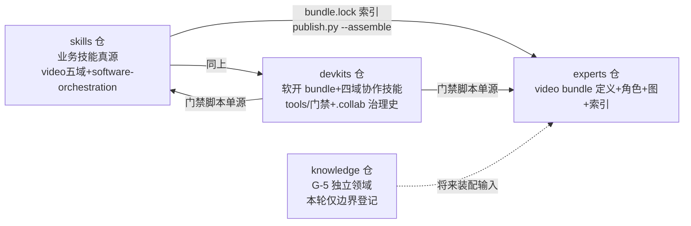

# 仓拓扑「维度分仓」架构设计 v1.1

## 【来源】帽

- 本席：架构师席（software-architect，Team: _auto_15e90588-7dd0-436b-9d06-de2f2118f90f）
- 当轮仓 HEAD 读数：`D:\multi-agent-collab-skillpack` @ `1ee7014`；`D:\multi-agent-collab-experts` @ `2438ddd`
- 上游输入：
  1. 产品经理席调研报告 `2026-10-26-仓拓扑维度分仓最佳实践调研报告_v1.md`（下称「PM 报告」，引用格式＝其问次＋表内出处编号，如「PM·Q2#5」；其「启示清单」以 #n 引用）
  2. 补证调研报告 `2026-10-26-跨平台维度耦合与装配部署补证调研报告_v1.md`（v1.1，下称「补证」，引用＝「补证·Qn」＋「补证·建议#n」）
  3. 需求澄清件 `2026-10-26-拆仓需求澄清件_v1.md`（下称「澄清件」，引用＝「澄清件·R-n / G-n」）
  4. 拍板登记 `.collab/decisions/2026-10-26-皮总拍板.md` 之「拍板四」（G-1~G-6/G-8 逐条裁定，引用＝「拍板四·G-n」，逐字为准）
- 性质：**v1 件就地修订为 v1.1**（拍板四落地回写）；不改其他既有文件；推荐案与待拍点分开，不替决策者拍板（G-8 留白）。

## 版本注记（v1 → v1.1，2026-10-26 就地修订）

修订依据＝拍板四（逐条引编号）；v1 原文（HEAD `01080ae` 时成文）中被修订处已在正文就地更新，A/C 案对比保留作史实。

| # | 修订项 | 依据 |
|---|---|---|
| U-1 | devkit 边界定案回写：所有用于多智能体协作系列**开发**的工具（不论开发对象是专家/技能/图/知识库）统一入 devkits 仓；被开发对象归各自维度仓。实证动机＝两 experts 同平台并行开发混淆（一份报告同时修两个子件；软开团队包实为开发视频团队包的开发工具） | 拍板四·G-1 |
| U-2 | B 案更新为**四仓终态**（devkits / experts / skills / knowledge 边界）；A、C 案保留作史实对比 | 拍板四·G-1/G-3/G-4/G-5 |
| U-3 | video 五域技能＋software-orchestration **出池**：真源入 skills 仓，编译时按专家包索引打包进 bundle（装配模型）；装配步口径由 v1「按需存在」更正为「**注册前必做**」（见 §3.3） | 拍板四·G-3 |
| U-4 | devkit 仓名定案＝`multi-agent-collab-devkits`（原待拍①关闭） | 拍板四·G-4 |
| U-5 | 跨平台落地形态回写＝按各平台机制编译的本地包＋MCP＋AGENTS.md；各维度本体只充料源素材；MCP 判据库化＝候调研（另一席在跑），本文**留接口不展开**（§7 候调研⑨） | 拍板四·G-2 |
| U-6 | §2.1 persona 行更正：v1 按 persona 诉求 v1 写的「独立 persona 件」承接 → 更正为「**随专家包耦合维护＋席位 MD 内 persona/流程分节**」；独立与否＝皮总待决，候 MCP/persona 范式调研回传后补依据，**不预设结论** | 拍板四·G-5/G-8 |
| U-7 | 新增 §5「图维度入题」：现状证据＋候选方向 a/b/c 对比＋最小承接（b 图资产化＝候补下一步） | 拍板四·G-6 |
| U-8 | 知识（人类决策经验）＝独立领域口径回写；本轮建仓与否按 YAGNI 给两选项＋倾向（先登记边界、不建仓，§2.3） | 拍板四·G-5 |
| U-9 | 任务列表重排 T1–T4（四仓终态·仓名已定）；待拍点逐条标状态（已裁/候调研/仍待拍，§7） | 拍板四·G-1~G-6/G-8 |
| U-10 | 基线豁免键口径如实重估：v1「不重生成」结论仅对「bundle 换仓」成立；出池后扫描面跨仓，基线需按新扫描面**重算一次**（范围见 §3.4） | 拍板四·G-3 |

---

## 0. TL;DR

- **终态＝四仓**：`multi-agent-collab-devkits`（开发工具包＝软开团队 bundle＋四域协作技能＋tools/ 门禁＋.collab 治理史＋将来图/persona 工具）／`multi-agent-collab-experts`（业务 bundle：video 只留 bundle 定义＋角色＋图＋索引，技能出池）／`multi-agent-collab-skills`（技能源仓：video 五域＋software-orchestration 等全部业务技能真源）／knowledge 仓（G-5 独立领域——本轮按 YAGNI 先登记边界不建仓，§2.3）。
- v1 推荐的第一刀（B 案骨架）不变，被拍板四**扩大**了两处：① devkit 边界从「软开 bundle＋四域技能」扩为「一切协作系列开发工具」（G-1）；② video 五域技能从「不出池」翻为「出池＋装配编译」（G-3）——v1 对 C 案「无第二消费者拆仓」的反对被拍板效力覆盖，本文如实改口径并补装配模型（§3）。
- 装配面＝**publish.py 扩展装配步**（R2）为唯一主路线：出池后 WorkBuddy 安装单元仍是 bundle，agents 的技能引用是包内相对式，**注册前必过装配**；MCP 判据库化留接口候调研（G-2）。
- 图维度正式入题（G-6）：v1.1 只定「**图资产化（b 案）为候补下一步**」的最小承接，不做运行时动态组图设计（WorkBuddy 平台不支持，§5）。
- persona 独立与否＝皮总待决（G-8），本文不预设；当前按 G-5 重申口径＝随专家包耦合维护＋席位 MD 内分节。

---

## 1. 方案对比

### 1.1 三案定义（B 案按拍板四更新为四仓终态；A/C 保留作史实）

| 案 | 仓拓扑 |
|---|---|
| **A 维持两仓（v1 时点现状）** | skillpack 仓（四域协作技能＋tools/＋.collab＋docs）＋ experts 仓（hjh-aigc-video-team ＋ hjh-software-team 两 bundle 并列，bundle 内技能随 bundle 走） |
| **B 四仓终态（v1.1，按拍板四·G-1/G-3/G-4/G-5 更新）** | **devkits 仓**＝现 skillpack 仓升格改名（四域协作技能＋tools/ 门禁＋迁入的 hjh-software-team bundle＋.collab 治理史＋将来图/persona 工具）＋ **experts 仓**（video 业务 bundle：只留 bundle 定义＋plugin.json＋agents＋avatars＋图＋**索引件**，五域技能出池）＋ **skills 仓**（新建：video 五域＋software-orchestration 等全部业务技能真源）＋ **knowledge 仓**（G-5 独立领域，本轮边界登记，见 §2.3） |
| **C 按维度全拆（史实保留）** | v1 时点定义：devkit／experts bundle 仓（抽走 bundle 内技能）／skills 源仓／knowledge·persona·图边界预留不出池——v1 曾以「video 五域无第二消费者」反对之；**拍板四·G-3 以决策效力裁定出池**，C 案的技能拆池部分被 B 吸收，persona/图独立仓仍不采 |



### 1.2 按 PM 报告三判据逐案检验（判据出处＝PM·Q1#2 reveneau 决策规则、Q1 结论）

| 判据 | A 维持两仓 | B 四仓终态（v1.1） | C 全拆（史实） |
|---|---|---|---|
| **① 耦合强度**（紧耦合应同仓） | 软开 bundle 与四域协作技能强相关却被仓界切开（v1 原判定不变）。 | 强耦合面（软开 bundle＋四域技能＋门禁＋治理史）收进 devkits 一仓恢复原子提交；video bundle 与业务技能解耦为**索引引用＋装配编译**——v1 曾判「五域无第二消费者、拆池纯增跨仓耦合」，该反对被拍板四·G-3 裁定覆盖：出池的正当性来源从「消费面」改为「维护面」（技能按维度独立维护＝皮总 G-1 目标）＋装配面补偿（编译回 bundle）。耦合成本由 §3 装配流水＋五条纪律承接，不再免费。 | 同 B 的技能拆池，但无 devkit 边界定案与 knowledge 登记，边界仍混。 |
| **② 归属／发布节奏是否分裂** | 软开 devkit（纪律高频）与 video 业务 bundle（内容低频）节奏分裂已被事实承认，仓界没跟上。 | devkits 按纪律演进独立 bump＋tag；video bundle 按内容 SOP 低频独立 bump＋tag；skills 仓按技能演进独立节奏——v1 判「video 五域节奏＝宿主 bundle 节奏、拆出是伪造第三节奏」，出池后该节奏**确实独立**（技能可先于 bundle 修订，装配时锁 tag），伪造风险改由 bundle.lock 版本锁消解。 | 同 B。 |
| **③ 访问边界** | 无外部消费者、单一维护者。 | devkits 仓＝工具包属性可外发（潜在边界）；skills 仓＝将来跨平台分发面（补证·Q4：SKILL.md 开放格式 46 平台采纳 A11）；边界收益比 v1 两仓版更实。 | 同 B，无 knowledge 登记。 |

### 1.3 迁移成本＋门禁接线改动面（v1.1 重估）

| 项 | A | B 四仓终态 | C（史实） |
|---|---|---|---|
| 文件迁移 | 零 | ① skillpack 仓改名 `multi-agent-collab-devkits`（本地目录＋GitHub 远端）；② 新建 skills 仓；③ video 五域技能＋software-orchestration 从两 bundle `git mv` 入 skills 仓；④ `workbuddy/hjh-software-team/` 整目录从 experts 仓迁入 devkits 仓 | B 全部＋（史实：persona/图也拆，未采） |
| run-gates.sh | 已适配 | 门禁脚本单源住 devkits 仓；experts 仓＋skills 仓各放**薄启动器**（§4）；`GATE_PROJECT_NAMES` 缺省值随仓名拆段更新 | 同 B＋路由表跨仓解析面更大 |
| SOT 对账 | 现状（DEFAULT_PKG＝`../multi-agent-collab-experts/workbuddy/hjh-aigc-video-team`） | **判据级改动**：出池后「agents vs skills 同包重合」对账对象跨两根（experts bundle 根＋skills 仓根），pkg 语义扩为双根输入（§3.4/§4） | 同 B |
| 基线豁免键 | 不变 | **需重算一次**——v1「不重生成」只对 bundle 换仓成立；出池改变扫描面口径，重算范围见 §3.4 | 同 B |
| 装配步 | 无（bundle 即成品） | **必建装配流水**（bundle 仓无技能，装不出完整可安装包）＝自研打包步全面落地（§3） | 同 B |
| 已记录失效风险 | 跨仓原子变更摩擦 | 门禁漂移（PM 启示#7）→ §4 单源对策；版本漂移（PM·Q1#5）＋装配产物与源不一致 → §3.2 五条纪律 | 三坑全暴露 |

**小结**：A 的问题＝软开 devkit 强耦合面被仓界切开＋皮总诉求零落地；C 的史实价值＝其技能拆池方案被 G-3 采纳后，其成本清单（版本漂移/门禁漂移/产物-源不一致）成为 B 终态必须付费的清单——v1.1 的 §3 装配流水就是这笔付费的账。

---

## 2. 终态拓扑＋理由（诉求→判据显式翻译，按拍板四回写）

### 2.1 皮总诉求逐条翻译（v1.1 回写版）

| 诉求 | 翻译成三判据语言 | 翻译结果 | 承接方式（v1.1） |
|---|---|---|---|
| 专家仓专门维护专家 | 专家 bundle＝装配单元，独立消费面＋独立发布节奏 | ✅ 成立 | experts 仓只留业务 bundle（定义＋角色＋图＋索引），技能出池（G-3） |
| 技能仓专门维护技能 | 业务技能＝能力层真源；出池后按维度独立维护（G-1 维护面裁定），跨仓耦合由装配流水补偿 | ✅ 成立（G-3 已裁，v1 的「仅对共享四域成立」口径作废） | skills 仓＝video 五域＋software-orchestration 等全部业务技能真源；四域协作技能按 G-1 属开发纪律工具→devkits |
| 图将来解耦则单独维护 | v1 判「须自证消费面」；**G-6 已裁正式入题**（实证＝派发混乱与主理人越权，符合 YAGNI 入题判据） | ✅ 入题（v1 的 ❌ 被 G-6 覆盖） | §5：图资产化（b）为候补下一步；图独立仓仍不建 |
| 经验知识（人类决策经验）独立维护 | G-5 已裁＝**独立领域**（定位：人格＝更有个性，知识＝更有品味、更像人）；仓级先例仍无（PM·Q4#9） | ✅ 领域成立；仓级时机待定 | §2.3 两选项＋倾向 |
| persona/思想框架独立维护 | G-5 重申＝随专家包耦合维护；G-8＝独立与否**皮总待决**，候调研依据 | ⚠️ 当前口径＝耦合维护＋席位 MD 内 persona/流程分节（补证·建议#1）；**独立与否不预设** | 席位 MD 分节＋persona 段复审标注；G-8 候 MCP/persona 范式调研回传后补依据（§7 待拍⑩） |
| 软开团队包＋相关技能＝独立开发工具包仓 | 三判据全过（v1 判定维持） | ✅ 成立 | devkits 仓本体；G-1 已把边界扩为「一切协作系列开发工具」 |

### 2.2 devkits 仓边界定案（G-1 回写）

**边界判据一句话：开发工具进 devkits，被开发对象归维度仓。**

| 资产 | 归属 | 依据 |
|---|---|---|
| 软开团队 bundle（hjh-software-team，bundle 定义＋席位＋图） | devkits 仓 | G-1 实证：软开团队包实为开发视频团队包的开发工具 |
| 四域协作技能（multi-collab／object-audit／object-build／external-advisor-collab） | devkits 仓 | 协作纪律＝开发过程工具（G-1「不论开发对象」口径） |
| tools/ 门禁＋object-audit/scripts 门禁脚本 | devkits 仓（单源） | 开发纪律工具；PM 启示#7 单源对策 |
| `.collab/` 治理史（decisions/research/inbox/evidence） | devkits 仓 | G-4 口径明示「.collab 治理史」属 devkits；PM 启示#9 元数据贴近被描述对象 |
| video 五域技能＋software-orchestration（业务技能真源） | skills 仓 | G-3 出池；被开发对象＝技能维度 |
| video bundle（定义＋agents＋avatars＋图＋索引） | experts 仓 | 被开发对象＝专家维度 |
| 将来图工具／persona 工具 | devkits 仓 | G-1「不论开发对象是专家、技能、图、经验知识库」 |
| 经验知识（人类决策经验） | knowledge 领域（§2.3） | G-5 |

### 2.3 knowledge 仓建仓时机（G-5 回写·两选项＋倾向）

G-5 已裁「知识＝独立领域」，未裁「本轮是否建仓」。两选项：

| 选项 | 内容 | 代价 |
|---|---|---|
| **K1 随拆仓同步建仓** | 本轮即建 `multi-agent-collab-knowledge`（仓名候皮总确认），先入空仓＋README＋元数据头体例规范件 | 无内容先有仓＝空转仓；仓名/边界未与 G-2 MCP 判据库调研对表，可能返工 |
| **K2 先登记边界，内容出生时建仓**（倾向） | decisions 登记一句「knowledge＝独立领域，真源住将来 knowledge 仓；当前人类决策经验真源＝devkits 仓 `.collab/decisions/`＋各 research 件」；出现首批需独立发布的知识真源（如品味/审美判据集）时再建仓 | 边界登记不落地有被遗忘风险→以 decisions 登记＋§7 待拍⑧对冲 |

**倾向＝K2**（YAGNI：无内容先有仓不满足准入；G-5 只定领域定性，未令建仓）。此为架构席倾向，呈拍不代拍。

---

## 3. 装配模型细化（G-3 核心）

### 3.1 出池后 bundle 编译流水

```
【源面】skills 仓：skills/<name>/（SKILL.md＋references/，技能自带版本头）
【索引】bundle.lock（住 bundle 所在仓，随 bundle 提交）——组件清单：
  component: aigc-video-governance   repo: ../multi-agent-collab-skills   ref: v1.4.0   path: skills/aigc-video-governance
  component: aigc-video-content      repo: …   ref: …   path: …
  （软开 bundle 同例：component: software-orchestration → skills 仓）
【装配】publish.py 扩展 `--assemble <bundle>`：
  读 bundle.lock → 逐组件按 ref（不可变 tag）从源仓取源 → 逐字复制进构建面 bundle/skills/<name>/
  → 写 COPY.state 账（source_sha256/copy_sha256_at_sync/source_commit）
  → 前置一致性校验（§3.2 纪律⑤）→ 产出**注册态 bundle**（含技能副本的完整可安装包）→ 部署面安装
```

### 3.2 五条纪律落点（PM·Q3 结论＋启示#5「缺一即事故」，v1.1 按四仓更新）

| 纪律 | 落点 |
|---|---|
| ① semver＋每次变更必 bump | skills 仓各技能版本头＋仓 tag；两 bundle `plugin.json` version；版本意图行住 devkits 仓 `.collab/versioning/`（Changesets 思路，PM 启示#6），装配步读取汇总 |
| ② 不可变 tag | 三仓各自打 tag（skills 仓＝`<skill名>@vX.Y.Z`；bundle 仓＝`<bundle名>@vX.Y.Z`）；发布后不移动不删除（PM·Q3#4）；tag＝装配输入的版本锁 |
| ③ 消费者锁版本 | 装配输入一律 `ref＝tag` 不用 HEAD；bundle.lock 记「组件→仓→tag→commit」四元组；COPY.state 单文件级锁不变 |
| ④ 产物不入库、不可手改 | 注册态 bundle（含技能副本）住 `build/` 或直写部署面，**不入任何仓版本库**（PM·Q3#7）；产物内嵌源 commit |
| ⑤ 发布前源一致性校验 | 装配前置＝各源仓 clean worktree＋HEAD==bundle.lock 登记 commit＋`publish.py --check` 五态全绿；任一不过＝fail-closed 拒绝装配 |

### 3.3 装配步口径更正（如实重估 v1）

v1 §3.3 曾定「装配步按需存在，不强制常态化（本地使用走部署面安装）」。出池后此口径**不再成立**：WorkBuddy 安装单元＝bundle，bundle 内 agents 的技能引用是包内相对式（`skills/<name>/…`，v1 §2.3 依赖护栏），源面 bundle 已无技能目录——**每次注册/发布前必过装配步**，否则装出的包缺技能。本地开发调试可仍用「部署面并列安装」省流水成本，但注册态产物必由装配产出。＝自研打包步从 v1 的「条件触发」升为「常态化必做」，这是 G-3 出池决策的确定成本，如实入账。

### 3.4 SOT 对账跨仓化＋基线豁免键口径重估（如实重估 v1）

- **v1 口径**：`tools/baseline-sot-dup.json` 「不重生成」——理由＝豁免键 files 集合是包根相对路径，bundle 换仓不改包内相对路径。**该结论只对「bundle 换仓」这一刀成立**（软开 bundle 无基线条目，换仓零影响，维持）。
- **出池后如实重估**：
  1. 现有 11 条基线条目的「出现文件集合」全为 `agents/…` 相对式（video 七席 MD）——agents 文件不出池、文本不改 → **11 条条目本身不失效**；
  2. 但 SOT「agents vs skills 同包重合」判据的扫描面从单包根变为**两根**（experts bundle 根＋skills 仓根）：技能文件进入扫描面后，与 agents 豁免行文本重合的命中落在豁免 files 集合外 → 假 BLOCK。
  3. **需重算的范围**＝video bundle 七席 agents × skills 仓五域技能（含 references/）全对账一次；豁免键 files 维度需跨仓路径口径（建议仓前缀两段式，如 `skills-repo:aigc-video-governance/references/…`），由脚本程序化重生成（禁手抄，基线件 note 纪律不变）。
  4. COPY.state 中五域技能文件的 `source_commit` 账随真源迁 skills 仓。
- 此口径变更须在 decisions 登记（「出池后基线按两根扫描面重算一次＋跨仓路径口径」），防后人照 v1 原文误判「不重生成」。

---

## 4. 门禁多仓接线（文件级·四仓版）

前提：门禁脚本单源住 devkits 仓 `deliverables/skills/object-audit/scripts/`（现状位置不动）。

| 文件 | 改法 |
|---|---|
| `run-gates.sh`（devkits 仓） | ① L130-131 `GATE_PROJECT_NAMES` 缺省拆段字面量改 `multi-agent`＋`-collab-devkits`（拆段拼接＝S-03 自伤规避不变）；② 加 `--gates-md` 参数（跨仓路由表定位）；③ SCRIPTS 清单加 SOT 第二调项（软开 bundle 变 devkits 仓内包 `--pkg workbuddy/hjh-software-team`）；④ 仓根定位逻辑不动 |
| `experts 仓/scripts/run-gates-launcher.sh`（新增·薄启动器） | 按并列目录约定定位 devkits 仓（`../multi-agent-collab-devkits/`，找不到＝exit 4 fail-closed）→ 调 devkits 仓 run-gates.sh。**不复制任何检查脚本**（PM 启示#7） |
| `skills 仓/scripts/run-gates-launcher.sh`（新增·薄启动器） | 同上，`--root` 指 skills 仓根；skills 仓需自建 `.collab/evidence/gates/`＋`.collab/inbox/主理人/` 骨架（launcher 首跑自动 mkdir，现脚本已有该逻辑） |
| `60-gates.md`（路由表·住 devkits 仓 multi-collab 域） | 不动结构；experts/skills 仓不新增 spec 前缀→`SPEC_ID_HOME` 映射表零改动 |
| `tools/check-source-of-truth.py` | **判据级改动**（§3.4）：pkg 语义由单包根扩为「bundle 根＋技能源根」双根输入；DEFAULT_PKG 跨仓默认随仓名改 `../multi-agent-collab-experts/workbuddy/hjh-aigc-video-team`（不变）＋新增技能根参数；软开 bundle SOT 走 devkits 仓内 `--pkg workbuddy/hjh-software-team` |
| `tools/baseline-sot-dup.json` | **重算一次**（§3.4 口径），脚本程序化生成；重算后登记 decisions |
| `check-entity.py`（S-03） | skills 仓根即技能目录→扫描域天然覆盖（仓根相对）；devkits 仓 `workbuddy/hjh-software-team/` 不在 deliverables/ 下→扫描域是否扩到 `workbuddy/**`＝仍待拍⑥（本设计默认**扩**） |
| `.collab/` 治理史 | 治理记录住 devkits 仓（G-4 口径）；experts/skills 仓 README 各放一行指针说明治理记录所在；呈拍去重（already_escalated）只扫本仓 inbox→跨仓同 spec 重复呈拍风险低，登记为已知边界 |

**运行前提**：三仓并列同一父目录（沿用拍板三⑤「两仓并列」前提，扩为三仓）。

---

## 5. 图维度入题（G-6 新增节）

### 5.1 现状证据

- 软开主理人已承载 **2 张图**：软件开发 SOP（住 software-orchestration 技能 references/：standard-sop／partial-workflows／quick-mode／bugfix-path 等）＋顾问讨论会 SOP（住 external-advisor-collab 技能）——图当前以「技能内 references 文档」形态存在，非独立资产。
- **实证问题**（G-6 原话）＝派发混乱与主理人越权；已有独立判别报告 `2026-10-26-席位派发失败根因判别报告_v1.md` 在案。符合 YAGNI 入题判据（实际验证中发现的问题），图维度议题正式入题。
- 平台对照（补证·Q2）：WorkBuddy＝图＋专家 bundle 内耦合（与 Claude Code plugin 同构，三档谱系①档）；「主理人席位作为资产控图」无平台先例（补证·建议#5，保留须标注本案自创）。

### 5.2 候选方向对比

| 方向 | 内容 | 判定 |
|---|---|---|
| **a 图留 bundle/技能内＝现状** | 图混在技能 references 里，无独立版本/owner | 维持即可，问题（派发混乱）不因维持而恶化，但也不提供解耦面 |
| **b 图资产化＝仓内独立资产＋编译进 bundle** | 图从技能 references 中分出独立件（自带版本头＋owner 元数据），住 skills 仓或 devkits 仓（子选择候拍），bundle.lock 索引引用，装配时编译进 bundle——**与技能出池完全同构，复用 §3 同一装配流水，零新机制** | **候补下一步**（v1.1 采纳的最小承接） |
| **c 运行时动态组图＝LangGraph 式** | 图/节点/专家分离，运行时按需求实例编译组合（G-6 理念原文） | **当前不可行**：WorkBuddy 无运行时组图机制（图＝bundle 内 plugin.json 编排，补证·Q2 矩阵；图维度平台锁定，补证·Q4#5/#6）——如实标注平台约束，非设计偏好 |

### 5.3 v1.1 最小承接（按 YAGNI）

只定「**b（图资产化）为候补下一步**」：不新建图仓、不做组图引擎、不预设图资产住哪个仓（skills 仓 vs devkits 仓＝待拍⑧子选择）。理由：派发混乱/主理人越权的根因修复未必需要图出池（判别报告已在案，修复走席位纪律/派发机制批）；图资产化的收益＝图可独立版本化＋装配面可替换，与出池技能共用同一 bundle.lock/装配流水，边际成本低——待「第二装配方复用同一张图」或「图需独立 bump」的事实时出现再启动（届时按 §3 流水加一行索引即可）。G-6 理念（编译组合面对不可预知需求实例）作为**方向登记**保留，其落地前置＝平台运行时能力，当前 WorkBuddy 不支持（§5.2-c）。

---

## 6. 任务列表（v1.1 重排·有序·含依赖·标注皮总侧动作）

> 任务粒度＝票；每票含多文件，不按单文件拆。仓名已定（G-4），T1 无命名前置。

| 票 | 内容 | 依赖 | 皮总侧动作 |
|---|---|---|---|
| **T1 拆仓票（四仓终态）** | ① skillpack 仓改名 `multi-agent-collab-devkits`（本地目录＋origin 远端）；② 新建 skills 仓 `multi-agent-collab-skills`（快照式 init 可——技能真源历史价值按拍板三③先例评估）；③ video 五域技能＋software-orchestration 从两 bundle `git mv` 入 skills 仓；④ `workbuddy/hjh-software-team/` 整目录从 experts 仓迁入 devkits 仓；⑤ 三仓 README＋仓定位声明（devkits＝开发工具包边界声明 G-1；experts＝只留 bundle 定义＋角色＋图＋索引；skills＝业务技能真源）；⑥ bundle.lock 索引件起草（两 bundle 各一份，先锁当前版本 tag） | 无 | **必须**：GitHub 建仓（skills 仓新建＋devkits 改名）、目录改名、授权跨仓 git mv；knowledge 仓 K1/K2 选项裁决（§2.3，倾向 K2） |
| **T2 门禁接线票** | §4 全部文件级改动：run-gates.sh（GATE_PROJECT_NAMES 改 `-collab-devkits` 拆段＋`--gates-md`＋SOT 第二调项）、experts/skills 仓薄启动器＋.collab 骨架、SOT 双根扫描面改造、基线按 §3.4 口径重算一次、check-entity 扫描域（按待拍⑥裁决）；跑通三仓各自 GATE PASS 为验收 | T1 | 无（check-entity 扩域＝待拍⑥） |
| **T3 装配流水票** | publish.py `--assemble` 扩展（bundle.lock 读取＋多源仓输入＋五条纪律落账＋clean worktree 前置校验＋注册态产物产出）＋版本意图约定（devkits `.collab/versioning/`）＋三仓 tag 规约落地＋装配后 bundle 注册验证（video bundle 为首个试验件）；WorkBuddy plugin.json 跨仓 source 能力验证（若通过＝出 R1 简化案退复制步，待拍②） | T1（T2 非硬依赖，可并行） | 无 |
| **T4 索引与 decisions 登记票** | 三仓 README 互指索引；decisions 登记（四仓终态决议＋「出池后基线按两根扫描面重算一次＋跨仓路径口径」＋「装配步注册前必做」＋门禁单源纪律＋knowledge 边界登记（若 K2）＋图资产化候补登记＋G-8 留白声明）；knowledge/persona 元数据头体例规范件（owner/review_date/version）；G-2 MCP 判据库接口占位说明（候调研回传后另批） | T1–T3 | 登记确认 |

执行顺序：T1 → T2 →（T3 ∥ T2）→ T4。

---

## 7. 待明确事项（原七条逐条标状态＋新增）

| # | 事项 | v1.1 状态 |
|---|---|---|
| 待拍① | devkit 仓名 | **已裁**＝`multi-agent-collab-devkits`（G-4） |
| 待拍② | WorkBuddy plugin.json 跨仓 source 能力 | **仍待拍/待验证**（执行级，T3 内验证；出池后即使支持跨仓 source，注册态仍走装配为主，验证结果只影响是否退复制步） |
| 待拍③ | 软开 bundle 迁入方式（git mv 保历史 vs 快照） | **仍待拍**（执行级；skills 仓新建方式并入此项一并裁） |
| 待拍④ | video 五域技能出池与否 | **已裁**＝出池（G-3），v1 默认「不出池」作废 |
| 待拍⑤ | knowledge/persona 资产级解耦本轮做否 | **部分已裁**：persona 当前口径＝随包耦合＋MD 分节（G-5）；knowledge 领域定性已裁（G-5），建仓时机 K1/K2 呈拍（§2.3，架构席倾向 K2）；元数据头体例规范件随 T4 落 |
| 待拍⑥ | check-entity（S-03）扫描域扩 `workbuddy/**` | **仍待拍**（执行级，本设计默认扩） |
| 待拍⑦ | 图出池触发条件登记 | **已被 G-6 覆盖更新**：图维度正式入题；v1.1 承接＝图资产化（b）候补下一步（§5.3），触发条件相应改为「第二装配方复用同图或图需独立 bump」，登记随 T4 |
| 新增⑧ | 图资产化后图真源住哪个仓（skills 仓 vs devkits 仓）＋knowledge 仓名与 K1/K2 | **仍待拍**（候补下一步启动时裁；不阻塞 T1–T4） |
| 新增⑨ | MCP 收窄为「人类经验判据类拟人化决策库」的价值与可行性 | **候调研**（G-2 明标，另一席在跑）——本文只留接口（T4 占位说明），不展开设计 |
| 新增⑩ | persona 独立与否（G-8） | **皮总待决**——候 MCP/persona 范式调研回传后补依据；本文按 G-5 重申口径执行（随包耦合＋MD 分节），**不预设结论** |

---

## 附：本设计引用的出处速查

- 三判据（耦合/节奏/边界）＝PM·Q1 结论＋Q1#2（reveneau）；原子提交收益＝PM·Q1#3；版本漂移失效模式＝PM·Q1#5
- skills 独立仓＋marketplace 跨仓 source＝PM·Q2#4/#5；依赖单向＝PM·Q2#2＋启示#3
- 五条纪律＝PM·Q3 结论＋Q3#1/#2/#4/#7；版本意图显式化＝启示#6；内容强相关同仓分包＝PM·Q3#10
- persona/知识资产级先例与仓级无先例＝PM·Q4 结论＋Q4#1/#3/#4/#5/#7/#9；主题分仓须翻译＝启示#1/#10；门禁漂移＝启示#7；元数据贴近对象＝启示#9
- 平台差异矩阵（图三档谱系）＝补证·Q2；SKILL.md 46 平台采纳＝补证·Q4#2（A11）；图/persona 平台锁定＝补证·Q4#5/#6；装配编译器无先例＝补证·Q4#8；席位 MD 分节先例＝补证·建议#1（OpenClaw/Hermes）；主理人席位自创标注＝补证·建议#5
- 需求还原＝澄清件·R-1~R-8/G-1~G-8；裁定＝拍板四·G-1/G-2/G-3/G-4/G-5/G-6/G-8（逐字为准）
- 派发混乱实证＝`2026-10-26-席位派发失败根因判别报告_v1.md`（在案，未引其结论细节）