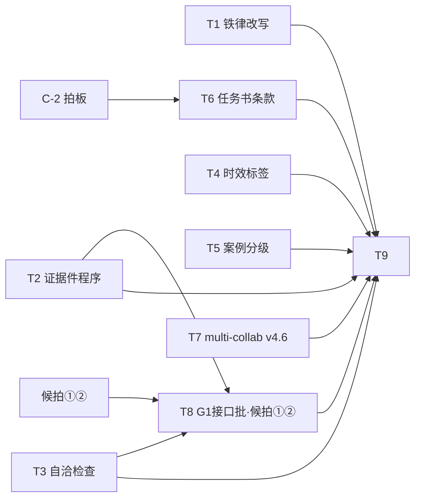

# 圣经生产流程整改——架构设计 v1（分层归属终判＋维度终判＋任务分解）

> **当轮 HEAD 实测**：`git -C D:/multi-agent-collab-skillpack rev-parse --short HEAD` = **`548c952`**（≥ 预期值，PRD v1 已入账）。
> **工作树声明**：`agents/aigc-video-team-lead.md` 有一处未提交改动（「（示例库）」括注＝W7 在途残留）。**本设计全部以 HEAD 版为基线**；lead HEAD 版 token 用 `git show HEAD:` 取流复算，不受工作树污染。
> **性质**：架构设计件（交接件）。只出设计，**未改任何交付物文件、未 commit**。执行归工程师、验证归 QA。
> **输入**：PRD v1（`2026-10-26-圣经生产流程整改需求PRD_v1.md`，HEAD `48e2548`）；复盘件（91 行全文）；决议稿 N1/N2（`2026-10-25-专家层与技能层架构决议稿_v1.md` §2.1/2.2/2.3）；维度标准 `object-build/references/10-skill.md`。
> **口径**：token 一律 `script-v1`（CJK≈1、非 CJK≈4 字符/token、**取整＝ceil**）；本件七席读数为 HEAD 版实测（非 PM 引用的字符数）。

---

## 〇、结论摘要

| # | 结论 |
|---|---|
| 0-1 | **PM 判层总体成立，本席改判/降级 3 处**：B-5 主落点由 content 域**改判 orchestration 域**（违例人是派单的主理人，咬点在派单时）；B-6 **降级**——「交接只认盘面」本体**已在 multi-collab 在册**（`20-handoff.md` §二＋`40-deployment.md` 原则 2），本条只剩「闸接口一行＋指针」；B-8 **拆半**——「自包含」已在册（`20-handoff.md` 自包含判据），「失败如实通报」**不在册**（multi-collab 全库 grep「如实/重试/故障」零命中），只补后半。 |
| 0-2 | **维度终判**：B-1 确属 D＋T 混装，**拆两件**（B-1a T／B-1b D）；B-3 判 **D＋F 合法混装不拆**（10-skill.md 第 3 步明文「D＋F 混＝合法：纪律带自己的词表」）；B-2＝T、B-4＝M、B-5/B-6/B-7/B-8＝D（B-5 为 D＋F）。PM 的 8 条候判中 6 条维持、2 条因降级/拆半改形态。 |
| 0-3 | **专家层 A-1/A-2 维持**，但补一个 PM 未写的落点事实：铁律六条在盘上有**两处**——lead MD L82 摘要行＋`iron-laws.md` 本体第 4/5 条。改写必须**两处同步**（摘要行是骨架行、本体是全文，骨架-本体是指针模型非双真源；只改一处＝语义漂移）。 |
| 0-4 | **A-1/A-2 联合净增预算只有 ＋7**（2,343→≤2,350）。候选措辞直算 **＋11**（A-1 ＋7／A-2 ＋4，`script-v1` 实测）超限——须先做**减项**：MD 摘要行铁律六「闸不可跳」的「，未获显式确认不执行」与「不确认不流转」同义重复，删之（**净 −10**，本体 iron-laws.md 第 6 条不动，骨架行冗余削减合法）。减后联合净增 **＋1 → 2,344**，红线内。 |
| 0-5 | **候拍 5 点全部按「拍 X→落点 Y」分支设计，本件不替皮总拍**；其中候拍①②改的是**同一文件同一行**（`confirmation-gates.md` G1 行）——任务分解中**合并为单一任务 T8**，防写冲突与双改。 |
| 0-6 | 任务分解 **9 个任务**：T1–T5、T7 六条并行无依赖；T6 候 C-2；T8 候拍①②；T9 收口依赖全部。 |

---

## 一、基线复算（HEAD `548c952` · script-v1 · ceil）

| 席位 MD | token | CJK | 非 CJK | 取整敏感 | 距 2350 |
|---|---|---|---|---|---|
| **lead** | **2,343** | 1,719 | 2,495 | 敏感 | **＋7** |
| editor | 2,333 | 1,628 | 2,819 | 敏感 | ＋17 |
| director | 2,300 | 1,575 | 2,898 | 敏感 | ＋50 |
| screenwriter | 2,285 | 1,711 | 2,296 | 不敏感 | ＋65 |
| operations | 2,188 | 1,286 | 3,606 | 敏感 | ＋162 |
| production-designer | 1,985 | 1,533 | 1,807 | 敏感 | ＋365 |
| content-strategist | 1,845 | 1,350 | 1,977 | 敏感 | ＋505 |

- lead **2,343 与主理人供料一致**（本席以 `git show HEAD:` 独立复算，四要素齐：`script-v1`／`548c952`／架构席／ceil）。PM 的「4,219 字符」是字符数，两数不矛盾，本件统一 token 口径。
- **本整改对专家层的可用水面＝lead 的 7 token**；strategist 有 505 余量（B-1 策划席侧半句可落它，见 §三）。

---

## 二、归属终判表（皮总硬要求 1＋2 的正面回答）

### 2.1 专家层（§A）——两条均**维持**，落点补一处

| # | 层归属 | 维度 | 落点文件 | 终判理由 |
|---|---|---|---|---|
| **A-1** 「主理人先验不是证据」 | **维持专家层**（N1③ 闸纪律铁律：删掉任何步骤它仍是完整纪律；「换一个人也必须一模一样」） | **D**（红线句＋负样本＝本次 v0 零证据起草＋被咬机制＝呈闸时引用驳回） | ① `agents/aigc-video-team-lead.md` L82 摘要行**原句内改写**；② `skills/aigc-video-governance/references/iron-laws.md` 铁律第 4 条**同步改写**（本体） | PM 判层正确。**补**：铁律在盘有两处（MD 骨架行＋iron-laws 本体），单真源模型＝「骨架行＋全文」，**两处语义必须同步**，验收含比对 |
| **A-2** 「圣经内部必须自洽（拼接≠消解）」 | **维持专家层**（N1③：「圣经是 SSOT 内部必须自洽」是「圣经先行」纪律的延伸；检查**程序**另立＝B-2，D/T 已按规则拆开——PM 这一刀切得对） | **D**（红线句＋负样本＝本次 v2「角色叙事 vs 旁白骨架」并存＋被咬机制＝呈闸引用驳回） | 同 A-1 两处（铁律第 5 条） | 维持。**纪律半句在 MD、程序本体在 skill**，正是 N1 三层拆解案的切法 |

**A-1/A-2 措辞与 token 账（本席终判，执行席照抄可用）**：

| 动作 | 原文（HEAD L82 片段） | 新文 | Δtoken |
|---|---|---|---|
| 减项（预算来源） | 闸不可跳（显式确认、沉默不算、不确认不流转**，未获显式确认不执行**） | 删粗体段（与「不确认不流转」同义；本体 iron-laws 第 6 条不动） | **−10** |
| A-1 | 成员结论为准（主理人只编排汇编） | 成员结论为准（主理人只编排汇编**·先验不是证据**） | ＋7 |
| A-2 | 圣经先行（未确认不开工） | 圣经先行（未确认**或不自洽**不开工） | ＋4 |
| **合计** | | | **＋1 → 2,344 ≤2,350 ✓**（三段 Δ 均 `script-v1` 直算实测，非估算） |

> 验收 grep 串：`先验不是证据`、`不自洽`（PM 判据 1 的「等价表述」在本席定死为这两串，QA 可判真假）。执行席若另拟措辞，须复跑 `script-v1` 且联合净增 ≤＋7。

### 2.2 技能层（§B）——逐条终判（含 B-1 拆件）

| # | 层归属终判 | 维度终判 | 落点文件（新件给建议名） | 终判理由（对照 10-skill.md／N1／N2） |
|---|---|---|---|---|
| **B-1a**（拆出）G1 证据件前置汇编程序 | 维持技能层·**orchestration 域** | **T**（入口＝涉市场/风格/形态条款起草前；步骤＝派专业席出证据件→主理人汇编；**停手条件**＝证据件不齐套；出口判据＝齐套清单可对账；产出件＝证据件包） | **新** `skills/aigc-video-orchestration/references/evidence-first.md`；改写 `bible.md`「起草」bullet 为指针句、`orchestration-steps.md` 步骤 2 同步 | 10-skill.md 第 3 步 D＋T 混（最常见）明文处置：**做法抽成 T 件，D 只留红线＋负样本**。程序有明确「做完了」＝T |
| **B-1b**（拆出）红线「证据件不齐不得呈 G1」 | 维持技能层·闸接口面**候拍①**（确认物清单＝闸接口表＝L0，N1 细则 1） | **D**（红线＋负样本＝本次 v0＋被咬＝呈闸时无证据件包即退回） | `confirmation-gates.md` G1 行「呈什么/确认前禁止」格（**候拍①后落**，与 B-2 接口合并＝T8）；`bible.md` 起草 bullet 内一句红线引用句 | 「证据不齐不得呈闸」是「确认前禁止什么」→ N1 细则 1 属闸接口；其**本体表述**落 confirmation-gates（已下沉的闸接口表），MD 骨架行 L63 **不动**（无 token 预算，⛓ 指针已在） |
| **B-1 策划席侧**（半句） | 维持专家层 strategist MD（拦截面在席位） | 非独立条款（A 类改写） | `agents/aigc-content-strategist.md`「辅助起草」bullet 原句内改写：「应主理人请求」→「**G1 前风格段证据件为默认派单**，应请求补充其他建议」（净增 ≤30，strategist 余量 505） | 被动改主动是权限面（白名单）不是程序；PM 把它裹在 B-1 里，本席拆出单列以免 T 件里混进行为权限 |
| **B-2** 自洽性检查程序 | 维持技能层·orchestration 域 | **T 维持**（入口＝每版定稿/冻结前；步骤＝叙述者唯一性/风格×形制×受众逐对/新旧逐对；出口＝冲突项＝0；产出＝自洽性检查表） | **新** `skills/aigc-video-orchestration/references/bible-consistency-check.md`；`bible.md`「改圣经」bullet 加一行指针；检查表**必含件化候拍②**（→T8） | PM 判 T 正确：四必填齐（入口/步骤含停手/出口/产出件）。负样本先验咬合＝拿 v2 跑必须报出冲突 |
| **B-3** 论据时效标签＋到期复核 | 维持技能层·orchestration 域（bible 所在域） | **D 主＋F 合法混装，不拆**（红线＝「待复核论据不得作新决策依据」；词表＝标签格式〔证据时间窗＋来源文件〕。第 3 步明文「D＋F 混＝合法：纪律带自己的词表」——PM 的疑虑在此不成立） | **新** `skills/aigc-video-orchestration/references/evidence-timing-label.md`；起算定义留占位（候 C-6）；存量回溯另任务（候拍③） | 主动复核若做成程序（扫描器）按 N2 判独立 skill——**本设计不做扫描器**：无既有判据脚本载体，且「引用前查标签」的咬合点是人工/抽查（D 型被咬机制允许人工）。登记为未来可脚本化项 |
| **B-4** 案例严格符合度检验 | 维持技能层·content 域 | **M 维持**（判据集＝结构同构分级；判法＝逐判据；反模式＝医言为定/扁小鹊；分级＝直接/弱同构/不适用。换对象同一套、无「一次做完」） | **新** `skills/aigc-video-content/references/case-evidence-grading.md` | M 四必填恰齐。M 测法＝换非视频域案例迁移测试（PM 判据已含） |
| **B-5** 调研任务书硬条款 | **改判：主落点 orchestration 域**（PM 判 content 域） | **D 主＋F 合法混装**（红线＝「缺任一条＝不合规任务书」＋可机检 grep；模板本体＝F 词表） | **新** `skills/aigc-video-orchestration/references/research-brief-template.md`；`content/references/brief-assessment.md` 加一行指针（策划席收单自检用）；主从候 C-2 | **改判理由：违例人是派单的主理人，咬点在派单时**——调研任务书由主理人写给策划席，「缺即不合规」的执行主体是编排面；按 N1②「单闸/派单执行程序→随 skill」归 orchestration。content 侧只是第二读位（指针），**不复制本体**（三守门①） |
| **B-6** 确认闸输入＝盘上文件 | 维持协作层·**降级为「闸接口一行＋指针」** | **D**（咬＝呈闸时无全路径即退回） | **不建新件**。`confirmation-gates.md`「统一确认纪律」段加一行：「呈审材料＝盘上文件＋全路径已给出，判据见协作层 multi-collab `20-handoff.md`」；multi-collab 侧**零改动** | **降级依据（在册实证）**：`20-handoff.md` §二「交接件规格·五件缺一不算交接件」＋自包含判据；`40-deployment.md` 原则 2「交接只认盘面，不认智能体内部」。**本体已在册，新立即双真源**——本条只剩闸侧接口面 |
| **B-7** 质疑先复述 | 维持协作层（PM 倾向成立，本席背书） | **D**（红线句＋负样本＝稻草人原案＋被咬＝抽查/人工；「复述错位被指出＝该轮作废重答」＝升级路径） | **append** 至 `deliverables/skills/multi-collab/references/30-formats.md`（应答形态节，v4.6 单独版本账＋90-changelog 登记）；aigc 包 `teammate-protocol.md` 加一行指针 | 稻草人不分项目（Q1「换一个专家也用同一套」）；30-formats 已有「身份切换复述」同族先例（§一），**两条复述场景不同、标题区分**，不合并 |
| **B-8a**（拆出）任务书自包含 | **降级为指针核对** | D（已在册） | **零改动**——`20-handoff.md` 自包含判据（空会话拿件能行动）＋`40-deployment.md` 原则 5「投递件必须自包含」在册 | C-4 核查结果：**在册**。新立＝碎片化 |
| **B-8b**（拆出）失败如实通报 | 维持协作层 | **D**（红线＝「重试 ≤2 次后如实报告失败点，不得让需求方对着沉默等待」＋负样本＝本次 1′36″ 静默失败） | **append** 至 multi-collab（与 B-7 同批 v4.6；建议 30-formats 回执域或 20-handoff，执行席按落笔上下文择一，**只许一处**） | C-4 核查结果：**不在册**（multi-collab 全库 grep「如实/重试/故障/沉默等待」零命中）。B-8 由「一条」拆成「一指针一 append」 |

**终判汇总**：D×5（B-1b/B-3/B-5/B-6/B-7）＋D 半条（B-8b）＋T×2（B-1a/B-2）＋M×1（B-4）＋指针化×2（B-6 本体、B-8a）。新文件 5 个、append 2 处、原句改写 4 处、在册零改动 2 处。

---

## 三、落点冲突检查（防双真源·对照 `MC-SOT-1`）

| 新条款 | 与既有件的重合面 | 处置（指针关系） |
|---|---|---|
| B-1a 程序 | `bible.md`「起草」bullet（括注软条款本体）＋`orchestration-steps.md` 步骤 2（同表述）＋`confirmation-gates.md` G1 行 | **程序全文只在 `evidence-first.md`**。bible.md 起草 bullet 改写为「起草时序与证据件程序 ⛓ 见 `evidence-first.md`」；orchestration-steps 步骤 2 同句改指；G1 行只写确认物（候拍①），不复述程序 |
| B-1b 红线 | 同上 G1 行 | 红线句全文只在 G1 行一格；evidence-first.md 内以「不齐套不得呈闸（判据见 confirmation-gates G1 行）」一句互指，**不复写红线全文** |
| B-2 检查表 | `bible.md`「改圣经」bullet（任何修改＝重新确认） | 检查程序全文只在新件；bible.md 该 bullet 追加「＋自洽性检查（程序 ⛓ 见 `bible-consistency-check.md`）」一行 |
| B-3 标签 | ①multi-collab `30-formats.md` §七 **A-15 市场事实库与引用治理**——A-15 是**一次性条目处置**（具体哪条引用降格/锚定），B-3 是**普适标签机制**，不重合但同族；②`gate-and-seat-addenda.md`「圣经三字段」＝音频档位，无关 | 新件文首登记一句「与协作层 A-15 的关系：A-15 管条目采信，本件管时效标签，互不复写」；防未来误判双真源 |
| B-4 分级 | `brief-assessment.md`（研究报告八节结构）无案例分级内容 | 无冲突；brief-assessment 若引用分级，指针指 `case-evidence-grading.md` |
| B-5 模板 | 跨项目记忆（生效中）＝**唯一真源悬置项** | **候 C-2**：拍「包内为真源」→ 新件为真源、记忆降级指针；拍「记忆为真源」→ 新件只放指针＋模板骨架（引用复刻，冲突时以记忆为准）。**两分支都已设计，不阻塞 T1–T5** |
| B-6 接口行 | `20-handoff.md`/`40-deployment.md` 本体 | 接口行只写「盘上文件＋全路径，判据见协作层」——**指针不复述**（三守门①）；验收含「aigc 包内 grep 三律本体＝0 命中」（PM 判据 2 原样采纳） |
| B-7/B-8b append | `30-formats.md` §一「身份切换复述」（场景不同）；`20-handoff.md` 自包含（B-8a 已覆盖） | append-only 新起小节，标题带场景限定词；不动 v4.5 既有任何行；90-changelog 记 v4.6 账 |
| **横向**：候拍①②同改 `confirmation-gates.md` **G1 行同一格** | — | **合并为单任务 T8**，一次改笔，防两拨执行席先后各改一次造成语义覆盖 |

**门禁预检**：新条款全部落 references/ 层（SKILL.md 只加索引行，`MC-SKILL-LINE` ≤5000 无虞）；`MC-SOT-1` 骨架-本体重合扫描在 T9 收口跑；路由表（60-gates §二）**本设计不新增 spec_id**——B 系列新检查点若需机检（B-5 的 grep 任务书），先以「QA 手工判据」落地，升格为路由表条目属 L0（改判据），**不在本设计内自加**。

---

## 四、任务分解（有序·含依赖·验收判据）

> 每任务＝一个工程师可独立收口的单元；「候拍」任务在拍板前**不得开工**，其余并行。验收判据可直接引用 PM 起判式（已标〔PM〕）与本席补充（已标〔架〕）。

| 任务 | 内容（文件＋改法要点） | 依赖 | 验收判据 |
|---|---|---|---|
| **T1 专家层铁律改写** | lead MD L82 摘要行三处改（§2.1 表：−10/＋7/＋4）＋`iron-laws.md` 第 4/5 条同步改写（本体语义一致、非逐字——本体无「未获显式确认不执行」冗余可留原样，只同步新增语义） | 无 | 〔PM〕grep `先验不是证据`/`自洽`＋lead ≤2,350＋桌面推演两例咬住；〔架〕摘要行与本体语义比对无漂移；`script-v1` 四要素申报 |
| **T2 G1 证据件前置（程序半）** | 新 `evidence-first.md`（T 四必填齐）；`bible.md` 起草 bullet 改指针；`orchestration-steps.md` 步骤 2 同步；strategist MD「辅助起草」bullet 原句改写（默认派单）；orchestration `SKILL.md` 索引表加行＋description 补触发词「证据件」 | 无 | 〔PM〕T 测法：零证据件桌面推演**走不到**呈闸步；括注内无「必须」级语义；〔架〕strategist ≤2,500；bible.md/steps 两处不再含程序全文（grep「先派.*证据件」全文只 1 命中） |
| **T3 自洽性检查程序** | 新 `bible-consistency-check.md`（T 四必填＋负样本 v2）；`bible.md`「改圣经」bullet 加指针行；SKILL.md 索引行 | 无 | 〔PM〕拿 v2 跑必报「角色叙事 vs 旁白骨架」，漏报＝无效；〔架〕检查表模板含「冲突项计数」字段（＝0 才出） |
| **T4 时效标签件** | 新 `evidence-timing-label.md`（D 红线＋F 标签词表；**起算定义留占位符 `〔候C-6〕`**）；SKILL.md 索引行；文首登记与 A-15 关系句 | 无（C-6 拍后回填占位） | 〔PM〕抽查 100% 双字段；负样本 2025-03 论据 2026-11 引用被拦；〔架〕grep 占位符在 C-6 拍后必须清零 |
| **T5 案例符合度分级** | 新 content 域 `case-evidence-grading.md`（M 四必填：判据集/判法/反模式医言为定·扁小鹊/三级分级）；content SKILL.md 索引行 | 无 | 〔PM〕3 例复测（2 否 4 是）＋非视频域迁移例判得出级 |
| **T6 调研任务书硬条款** | 新 orchestration 域 `research-brief-template.md`（D 红线＋F 模板）；`brief-assessment.md` 加指针行；SKILL.md 索引行 | **候 C-2**（真源主从） | 〔PM〕grep 时间窗/横切面 零命中＝不合规；负样本＝本次一轮任务书必被判不合规；〔架〕C-2 拍「记忆为真源」时本件降格为指针件，模板全文不落盘 |
| **T7 multi-collab v4.6 append 批** | ①B-7 复述纪律 append `30-formats.md`；②B-8b 失败通报 append（30-formats 或 20-handoff 择一）；③`90-changelog.md` v4.6 账；④aigc 包 `teammate-protocol.md` 加 2 行指针；⑤`confirmation-gates.md` 统一确认纪律段加 B-6 接口行（一行，指针式） | 无（append-only，不重构 v4.5 任何行） | 〔PM〕歧义质疑推演首句必复述；aigc 包 grep 三律本体＝0；〔架〕v4.5 既有行 diff＝0（只增）；版本账与 SKILL.md `version: 4.6` 同步 |
| **T8 G1 闸接口批（候拍①②合并）** | `confirmation-gates.md` **G1 行一次改笔**：拍①硬→「呈什么」格加「＋风格段证据件包」；拍②硬→同格加「＋自洽性检查表」；「确认前禁止」格加 B-1b 红线句（拍①硬时）；orchestration SKILL.md description 若需补触发词一并 | **候拍①②**＋T2、T3 | 〔PM〕B-1 判据 2 拦截句可 grep；〔架〕G1 行改后与 evidence-first/consistency-check 两件互指不双写；lead MD 骨架行 L63 **零改动** |
| **T9 收口** | 七席＋五域 SKILL.md token 复算（script-v1）；`MC-SOT-1` 双真源扫描；门禁全跑（pre-commit 链）；README 计数表更新；本件占位符清零核验 | T1–T8（T6/T8 按拍板态） | 〔架〕七席 ≤2,500 全绿；SKILL.md ≤5000 级；SOT 扫描零新增 BLOCK；四要素读数入账 |

**依赖图**：

**次序理由**：T1 独立且最小（先落，专家层红线先咬合）；T2/T3 是 T8 的语义前置（接口行指向的程序件必须先存在——**references 先建、指针后改**，同既往 P 系列原则）；T7 与包外真源相关但 append-only 可先行；T8 唯一候拍任务，把全部 L0 触点收在一格内，拍板前后仓内都无悬空态。

---

## 五、候拍决策点矩阵（呈皮总·本件不拍）

| 候拍 | 拍 A → 设计后果 | 拍 B → 设计后果 |
|---|---|---|
| **① G1 确认物清单加「风格段证据件」** | T8 改 G1 行「呈什么」＋「确认前禁止」两格；G1 呈审材料＝圣经＋证据件包；B-1b 红线句落 G1 行 | 清单不动：B-1a 程序照建（内部时序仍强制），但**无闸侧拦截**——退回纯流程纪律，咬合只剩桌面推演；**本席如实标注：拍 B 则 Q-02/Q-09 的防线从「闸拦」降为「自觉」** |
| **② 自洽检查表成 G1 必含件** | T8 同格加「＋自洽性检查表」；T3 出口判据与 G1 输入闭环 | 检查表照产出、不作必含件；冲突靠 A-2 铁律句人工驳回 |
| **③ 时效标签回溯 v3 存量** | 追加任务 T4b：v3 圣经逐论据补标签（**改确认物＝触发圣经变更流程：重新确认＋变更记录一行**——此连带后果皮总须知） | 只管增量：v3 存量裸奔，下次修订时顺带补（标签件内写「修订触及即补」条款） |
| **C-2 包内 vs 记忆双真源主从** | 包内为真源、记忆降级指针：T6 全量落地，**跨项目记忆需人工改指针（本仓外动作，须派工）** | 记忆为真源：T6 降格指针件；**代价如实报**：记忆随宿主不随包分发，换宿主＝条款消失，Q-03 复发无防线 |
| **C-6 「6 个月」起算定义** | 按**采集日**起算：标签词表含「采集日」必填字段，机检＝比对采集日与引用日 | 按**发布日/定稿日**起算：词表字段改「定稿日」；**代价**：定稿日可能远晚于采集日，旧论据借新定稿「续命」 |

**合并呈拍建议（C-5）**：①②同文件同格、③与 C-6 同件占位——建议 **①②③ 一次呈、C-2 与 C-6 一次呈**，共两轮；本设计两分支均已备好，任一轮拍完即可开工对应任务。

---

## 六、三态自查（绿／未绿／移出）

| # | 自查项 | 态 |
|---|---|---|
| 1 | 开端 HEAD 读数（`548c952`，≥预期） | **绿** |
| 2 | A-1/A-2 层归属终判＋落点＋措辞＋token 账（净增 ≤＋7 有减项来源实证） | **绿** |
| 3 | B-1~B-8 维度终判逐条（含 B-1 拆件、B-3 不拆理由、B-6/B-8 在册核查证据） | **绿** |
| 4 | 落点冲突检查（8 组重合面全枚举、指针关系定死、候拍①②同格合并） | **绿** |
| 5 | 任务分解（9 任务、依赖图、每任务验收判据含 PM 起判式引用） | **绿** |
| 6 | 候拍矩阵（5 点全分支、未替皮总拍） | **绿** |
| 7 | 新件正文质量（T 四必填/M 四必填逐项落点） | **未绿**——本件只定字段与判据，正文归工程师（T2–T6），QA 按 10-skill.md 第 2 步按型自测验收 |
| 8 | B-3 复核扫描器（脚本化） | **移出**——本设计判「人工/抽查」咬合够用，脚本化登记为未来项（不新立 spec_id，升格属 L0） |
| 9 | 跨项目记忆改指针动作（C-2 拍 A 时） | **移出**——本仓外，须主理人另派工 |

**边界声明**：本件只写 `.collab/research/`；未改 `deliverables/` 任何文件、未 commit；工作树 lead.md 的 W7 残留未触碰；行号均为 `548c952` 快照非稳定锚，落地以节名定位。
