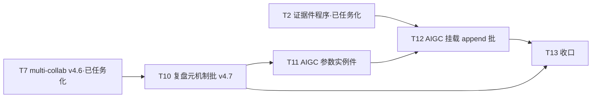

# 复盘能力分层设计 v1（分层终判 Q-a～Q-e ＋ M1～M5 调研表态）

> **当轮 HEAD 实测**：`git -C D:/multi-agent-collab-skillpack rev-parse --short HEAD` = **`9764bdb`**（＝复盘件 v2 效力更正 commit，M1～M5 降级为皮总个人意见提议版已入账，本件以其为需求基准）。
> **性质**：架构设计件（R-01' 派工件）。**只设计、不改盘**——未改任何交付物文件、未 commit；所有落点只给建议名，不建文件、不预设交付物改动。执行归工程师、验证归 QA，且一律候皮总拍板后启用（§四 T10+ 草表）。
> **输入清单**（全部实读，取证见 §六）：
> ① 需求件 `.collab/research/2026-10-26-专家团项目复盘-问题池补充对照_v2.md`（§三 R-01'/R-02'、§六 M1～M5、§一 归属表）；
> ② 决议稿 `.collab/research/2026-10-25-专家层与技能层架构决议稿_v1.md`（§2.1 N1 三层拆解案＋三守门、§2.2 N2 承载判据、§2.3 Q3 分层形态／Q6 token 分轨）；
> ③ 维度标准 `deliverables/skills/object-build/references/10-skill.md`（D/T/M/F 四型＋边界四道尺＋拆分正当条件）；
> ④ 挂载先例 `deliverables/profiles/aigc-video-team/skills/aigc-video-governance/references/teammate-protocol.md`（六席共用真源＋席位变量位先例）；
> ⑤ 前序设计件 `.collab/research/2026-10-26-圣经生产整改架构设计_v1.md`（体例参照；T7④ 对 teammate-protocol 的 append 排程冲突面）；
> ⑥ 佐证件：`2026-10-26-20261026a讨论会协作复盘报告_v1.md`（七缺陷＋红线锚）、`deliverables/skills/multi-collab/SKILL.md`（真源归属条款·收口自检）、`deliverables/skills/object-audit/SKILL.md`（构建/审计分期）、`deliverables/profiles/aigc-video-team/skills/aigc-video-orchestration/references/orchestration-steps.md`（SOP 步骤面）。
> **token 口径声明**：一律 `script-v1`（CJK≈1、非 CJK≈4 字符/token、取整＝ceil）。lead MD HEAD 版本席独立复算＝**2,343**（CJK 1,719／非 CJK 2,495，`git show HEAD:` 取流），距目标线 2,350 余 **7**，与前序设计件读数一致。
> **团队限定词**（皮总纠正后口径，本件全文遵守）：「软开主理人」＝齐活林（软件开发团队）；「视频制作人」＝`aigc-video-team-lead.md` 席位（AIGC 视频制作团队 lead）。

---

## 〇、结论摘要

| # | 结论 |
|---|---|
| 0-1 | **Q-a 终判：统一复盘方法论真源落 `multi-collab` 域新分卷**（建议名 `references/80-retrospective.md`，T 型程序件）。object-build 新分卷**驳回**（复盘是运行时工序，object-build 是编译期构建器，期别错位）；新立元机制域**驳回**（不满足 10-skill.md 拆分四正当条件，每轮 +100 固定税，违「入口少、分件多」方向）。 |
| 0-2 | **Q-b 终判：不各立团队复盘 skill 实例**——统一方法论一件 ＋ 团队参数实例件（AIGC 侧＝governance 域引用复刻参数件；软开侧＝参数直接写在真源件的项目 profile 注入节）。依据：决议 Q3「按能力域横切建库、**严禁按角色/席位分层**」＋ 10-skill.md「对象差别落触发条件而非模块边界」。 |
| 0-3 | **Q-c 终判：不制定席位专属复盘 skill**——统一模板内按席位给**检查面参数表**，复用 `teammate-protocol.md` 已验证的「席位变量位」机制（`{席位动名词}` 同款）。 |
| 0-4 | **Q-d 终判：AIGC 挂载面＝三个非席位 MD 触点**（teammate-protocol append 复盘节＝六席确定性触发；orchestration-steps append 收口复盘步＝视频制作人确定性触发；governance SKILL.md 索引行＋触发词），**七席 MD 净增 token＝0 达成**（lead 2,343 不动）。软开侧挂载面＝multi-collab 本体（SKILL.md 收口自检节一行＋分卷索引行＋触发词）——本团队无席位 MD 落盘件，multi-collab 即本团队席位行为的常驻纪律载体。 |
| 0-5 | **Q-e 终判：接口＝「工序 vs 收件域」分工，零新机制**——统一复盘＝方法论/工序层（何时复、怎么复、产物何样、如何分流）；`external-advisor-collab`＝讨论会程序的程序域＋复盘归因的**收件域之一**。七缺陷复盘是该工序的**已完成历史实例**，其能力层产出已按 M5 分流落 external-advisor-collab 需求基线（R-03' 已拍），无需回补。 |
| 0-6 | **M1～M5 表态：采信 2（M1/M4，各附注）＋改判采信 3（M2/M3/M5）**，无整条驳回；三处改判均为实质修正（M2 补「定义缺失」查问、M3 划清审计席边界、M5 分流补「无归因」兜底态），详见 §二。 |
| 0-7 | **排程防冲突**：T1–T9 实测均未执行（orchestration references 无 `evidence-first.md`、teammate-protocol 无 T7 指针行）；T12 与 T7④ 同文件（teammate-protocol）、与 T2 同文件（orchestration-steps），**T12 显式依赖 T7、T2，串行 append-only**，见 §三/§四。 |

---

## 一、分层终判表（Q-a～Q-e 逐条）

### Q-a 元机制层：统一复盘方法论归哪个域承载

**终判：归 `multi-collab` 域，新分卷承载。建议名 `deliverables/skills/multi-collab/references/80-retrospective.md`（编号续位：现有 10～70＋90，80 空档）。**

**内容定性（先判型再落点，对照 10-skill.md）**：

| 成分 | 型 | 承载方式 |
|---|---|---|
| 复盘程序（触发→读本席定义→对照生产实例→归因→分流） | **T**（入口＝触发时机；步骤含停手条件；出口判据；产出件＝复盘件） | 80 件本体 |
| 准入判据「每条问题必带验证出处」（R-02' 并入处） | **T 的出口判据字段**，非独立 D（「缺验证出处＝复盘件不合规」即出口判据；T 必填表本就含出口判据，**不构成 D＋T 混装**） | 80 件内 |
| 复盘件模板（本体问题节／能力问题节／分流标签） | T 的产出件规格 | 80 件内 |
| 分流标签规格（能力层→开发团队收件／本体层→经验库·无库仅记录／无归因→仅记录） | 同上 | 80 件内 |

**三个候选的判语**：

| 候选 | 判 | 理由 |
|---|---|---|
| object-build 域新分卷 | **驳回** | object-build 自我定位「本器＝构建期（construction）」（SKILL.md 原文），六支分件全是编译期对象规范（造 skill/角色/票/目录）；复盘是**运行时对生产实例的行为审查工序**，期别错位。硬塞＝object-build 构建三问的「②哪个期」自相矛盾。object-audit 同理驳回（审计对象＝交付物对象，非席位行为；且构建/审计两器「不互抄」）。 |
| 新立元机制域（独立 skill 包） | **驳回** | 10-skill.md 成本边界拆分四正当条件（独立运行时／独立版本节奏／可单独卸载／共享中间产物代价）四条**一条不满足**；「拆只是把内容从按需付费挪到每轮付费」——新包＝每轮 +100 token 固定税，且复盘与交接件/收口/回执**高共现**（官方共现度判据反向：常一起用就不该分路径）。 |
| multi-collab 侧 | **采信** | ① multi-collab 自我定位＝「协作纪律真源，方法论与具体项目解耦、可整包移走」——复盘元机制正是跨团队跨项目的协作行为纪律（两线实证＝试生产协作线＋讨论会协作线，全部落在协作过程维度）；② 复盘产物（归因结论＋分流）的投递走的就是 multi-collab 的交接/上报通道，与 `20-handoff.md`/收口自检同族高共现；③ N2 合规：主动程序由 skill 承载——程序由 multi-collab 这个 skill 承载、本体在其 references 分卷，与 B-1a/B-2 等 T 件落域内分卷的既有先例同构；④ 版本账现成（v4.5→T7 v4.6→本件候 v4.7）。 |

**token 账**：80 件为分卷＝按需付费（Level 3），不占每轮税；multi-collab SKILL.md 只加索引行＋触发词（≤5000 级内，v4.5 正文余量充足）。

### Q-b 专家团层：两团队是否各立复盘 skill 实例

**终判：不各立。统一方法论一件（Q-a）＋ 团队参数实例两件（参数≠方法论复写）。**

- **依据一（决议 Q3 明文）**：「按能力域横切建库、**严禁按角色/席位分层**」——按团队各立 skill 实例＝按团队分层的近亲，方法论会随两份实例各自漂移成双真源。
- **依据二（10-skill.md 反例警示）**：对象差别（此处＝复盘对象不同：AIGC 闸/片/工序 vs 软开 票/讨论会/批次）的正确落点是**触发条件与参数**，不是模块边界（buf lint「按对象命名 ≠ 按对象分模块」同款）。
- **实例层形态**：
  - **AIGC 侧**：`deliverables/profiles/aigc-video-team/skills/aigc-video-governance/references/seat-retrospective.md`（建议名·**参数实例件**）——只承载：复盘对象清单（闸/片/工序）、触发时机、席位×检查面表（Q-c）、指向元真源的 ⛓ 指针；**不复制方法论本体**（三守门①）。若 AIGC 包独立分发导致跨包指针失效，按「引用复刻＋冲突以真源为准」条款处置（先例＝multi-collab SKILL.md 真源归属条款＋T7⑤ 跨包指针），独立分发问题列 §五 待确认 ①。
  - **软开侧**：不建实例件——软开团队即 multi-collab 宿主，参数（票/讨论会/批次＋触发时机）直接作 80 件内「项目 profile 注入节」的默认值段承载（10-skill.md 第 5 步「项目值留占位与注入说明」同款：真源件写占位与注入说明，软开项目侧填值）。
- **统一/区分结论一句话**：**方法论统一、对象参数区分、触发条件区分**；「团队实例层」以参数件存在，不以 skill 存在。

### Q-c 席位层：席位专属复盘视角 vs 统一模板＋检查面清单

**终判：统一模板 ＋ 席位检查面参数表。不制定席位专属复盘 skill/视角。**

- **依据**：① 决议 Q3 严禁按席位分层（同 Q-b）；② M2/M3 元机制本身要求「任何席位统一遵守」（皮总提议原文亦明示这 2 点是「不论任何席位的专家都应该统一遵守」）——席位差异若进方法论即破坏元机制统一性；③ **盘上先例已验证**：`teammate-protocol.md` 用单一真源＋`{席位动名词}` 变量位服务六席，复盘检查面完全同构复用此机制。
- **落法**：席位×检查面表落在**团队参数实例件**（AIGC＝seat-retrospective.md 内一张表），不进元真源 80 件。AIGC 表示意（候拍后由工程师成文，本件只定行列）：

| 席位 | 复盘对象（生产实例） | 检查面（对照本席定义件查什么） |
|---|---|---|
| 内容策划 | 选题简报 | 证据出处齐否、时效标签、案例符合度 |
| 编剧 | 脚本 | 圣经自洽遵循、依据/出处/时效必填 |
| 美术指导 | 美术设计方案 | 风格从圣经推导链、一致性检查清单覆盖 |
| 导演 | 分镜＋镜头生成方案 | 提示词方案与已确认件偏差、预算申报 |
| 剪辑师 | 成片＋自检清单 | 自检是否被当放行（产品检≠行为复盘）、重生成归因 |
| 运营 | 审核报告 | 指标回流是否替代了自身行为复盘（A-18 教训） |
| 视频制作人 | 派单件／闸呈报件／收口件 | 任务书合规、闸序执行、汇总如实、**组织各席复盘＋自复** |

### Q-d 挂载面

**AIGC 包（硬约束：七席 MD 净增 token＝0，lead 2,343 距线仅 7，禁加行）**——挂载全部走**非席位 MD 触点**：

| 触点 | 改法 | 触发的席位 | 性质 |
|---|---|---|---|
| `governance/references/teammate-protocol.md` | **append 新节**「复盘（收尾退出前）」一行指针 ⛓→seat-retrospective.md（不重编号既有五步，append-only） | 六席（该件已是行前必读＝确定性通道） | 分卷 append |
| `orchestration/references/orchestration-steps.md` | **append 收口复盘步**（SOP 末步：主理人组织各席复盘＋自复，指针 ⛓ 同上） | 视频制作人（lead MD L98 已有 ⛓ 指向本件，确定性） | 分卷 append |
| `governance/SKILL.md` | 索引表加 seat-retrospective.md 行＋description 补触发词「复盘」 | 语义兜底（非确定性，仅第二通道） | SKILL.md 行（≤5000 级） |

- **席位 MD 改动＝零**：lead 2,343 不动、六席不动，**净增 token＝0 达成**；副作用如实报：teammate-protocol 为六席行前必读，append 一节≈+40~60 token/席/会话（分卷侧、非 MD 红线口径内），可接受。
- **软开团队侧挂载面**：本团队无 teammate-protocol 对应件（席位行为定义＝multi-collab 条款本身，随协作模式常驻）。挂载面＝**multi-collab 本体三触点**：① 80 件（真源，Q-a）；② SKILL.md 索引行＋触发词「复盘」；③ SKILL.md「收口自检」节加一行「收口时按 80 件执行/组织复盘（指针）」。软开主理人的批次收口/讨论会收口即触发点，走③的确定性通道（收口自检本就是主理人机械核清单）。

### Q-e 边界：讨论会程序复盘与统一复盘能力的接口

**终判：「工序 vs 收件域」分工，接口零新机制。**

| 面 | 归属 | 说明 |
|---|---|---|
| 讨论会**程序本身**（拟题/主持/汇总/收口纪律） | `external-advisor-collab`（软开域，待立项） | 统一复盘 skill **不吞并**：它不定义讨论会程序、不判程序合规——同「判定权不下放」守门 |
| 讨论会**复盘**（主持人自复七缺陷类行为） | 统一复盘工序的一个**实例**（复盘对象＝讨论会程序执行，参数落软开侧参数段） | 触发时机＝讨论会收口后；执行者＝软开主理人（对照自身定义＝multi-collab 主持人条款，M2 改判口径见 §二） |
| 复盘**产出分流** | M5 分流标签「能力层→开发团队收件」＝落对应域 skill 的**需求池**（讨论会类→external-advisor-collab 需求基线；协作纪律类→multi-collab 版本账；AIGC 包类→AIGC 包整改账本） | 七缺陷复盘＝该工序的**已完成历史实例**：其能力层产出已按此路落 R-03' 需求基线（已拍），本体层产出（内容本体意见）已按红线移出——接口无需回补，未来同类复盘直接按 80 件跑 |

**防吞并判据（写进 80 件边界节）**：统一复盘件只回答「何时复、怎么复、产物何样、分到哪」；「复哪个程序的细节规矩」（如讨论会收口判词校验清单）一律落收件域自己的件，80 件只留分流路由，不留收件域条款。

---

## 二、M1～M5 逐条调研表态（皮总个人意见提议·非拍板·本席独立评估）

**评估基准**：决议 N1/N2/Q3、讨论对象永久红线（「本项目讨论对象永远只有生成内容的专家、技能等生产力工具，永不讨论内容本体」——第三轮汇总件作废注记原文）、单真源三守门、multi-collab 席位模型与写权结构。

| # | 表态 | 调研理由（对照基准） | 修正/附注内容 |
|---|---|---|---|
| **M1 双层清晰分层** | **采信**（附红线自洽注） | 与 N1 专家层定义（席位定义＝身份层常驻）自洽：能力层归因的对象正是「席位定义/绑定 skill」；模板两节制使「本体是表、能力是根」成为产物硬结构，八问题 5 条靠外指即「只复本体」反例的正治。 | **注**：「本体问题」节限「现象记录＋出处指向」，**不得展开本体质量分析**——否则复盘工序自身踩「永不讨论内容本体」红线（讨论会前三轮即栽在此）。操作化「本体问题须有能力层归因指向（或明示无）」原样保留，此句即红线在模板里的闸。 |
| **M2 对照自身定义** | **改判采信** | 方向成立：复盘依据＝本席定义件，与 D 型「红线＋负样本」结构同构（对照定义查偏差＝查负样本）。但**按原操作化跑不通两类真实案例**：① AIGC 五问题根因是**定义本身缺条款**（teammate-protocol 五步无复盘步）——「对照定义查行为偏差」在定义沉默时无从查起；② 软开团队席位**无席位 MD**（席位定义＝multi-collab 条款），「读本席定义件」字面无对象。 | **改两处**：① 复盘第一步改「读本席定义与绑定条款」，定义件形态随团队实态（AIGC＝席 MD＋绑定 skill；软开＝multi-collab 角色条款）；② 程序固定**两问**：一查行为是否偏离定义，二查**定义是否覆盖该情形**——「定义缺失/定义缺陷」即能力层问题主源，只查偏离不查缺失则 M1 能力层归因空转。 |
| **M3 只复盘自己** | **采信**（附边界注） | 与写权结构天然咬合：席位无交付物写权（唯一写＝执行者），本席复盘件越界指责他席既无执行权又污染归因；「见他人问题→既有交接/上报通道」＝20-handoff/消息路由现成件，零新机制。 | **注**：M3 约束的是**本席复盘件的归因范围**，不侵蚀 multi-collab 审计席职能——审计（审对象交付物）≠复盘（复自身行为），两器不混（object-build/object-audit「不互抄」同款分立逻辑）。此注防「M3 万能化」误读为「任何席位不得指出他人问题」。 |
| **M4 目的两层·非本体** | **采信** | 即「讨论对象永久红线」在复盘工序的目的层表述，与红线同源同向（红线作废注记三例实证了目的错位代价）；「产物评价标准＝对开发者迭代/经验积累的可用性」给了复盘件的可测判据，直接可入 80 件出口判据节。 | 无修正。落地补一句：对成片质量的**直接**贡献不作复盘验收项（间接贡献经能力层改进实现），防复盘工序被成片指标绑架回本体。 |
| **M5 只产出归因结论＋分流** | **改判采信** | 骨架成立且与架构强自洽：①「只归因不修复」＝判定权不下放＋席位无写权的产物侧镜像；② 分流＝红线在产物面的落地，自洽成立（**记录≠讨论**：本体层归因仅记录/入库，不进入任何讨论对象）；③「暂无库则仅记录」已自带经验库缺位的降级路径，YAGNI 合规。 | **改一处**：二分流转补**第三态兜底**——纯环境故障（如 1′36″ 静默失败中的网络层半段、八问题 8 环境故障）既非「专家团自身文档缺陷」也非内容本体，按原二分只能错标能力层或丢弃；增「**无归因（纯环境噪声）→仅记录**」态。能力层/本体层两态与去向（开发团队收件／经验库·仅记录）原样维持。 |

**总评**：五条无与既有决议的正面冲突，整体骨架采信；三处改判均为「按原文跑不通」的实态修正而非方向否定。**建议皮总按修正后文本采信**；M2 两问与 M5 三态若被产品经理调研另行修正，本件 §四任务表按最终拍板文本执行即可（任务表不锁死 M 文本）。

---

## 三、与既有件的指针关系与双真源检查（含 T7 排程防冲突）

### 3.1 指针关系图（本设计新增的指向，全部单真源）

| 新触点 | 指向 | 双真源自查 |
|---|---|---|
| multi-collab `80-retrospective.md` | 元方法论**唯一全文**（程序/准入/模板/分流） | 与收口自检（SKILL.md）：收口自检＝机械核清单，复盘＝行为归因工序，场景不同不重合；收口自检节只加指针行不复述程序 |
| AIGC `seat-retrospective.md` | 只承载参数（对象清单/触发时机/席位×检查面）＋ ⛓ 指 80 件 | **不复制方法论本体**（三守门①）；若 §五① 拍「独立分发需自包含」→ 升引用复刻件并登记「冲突以 multi-collab 为准」（先例条款现成），仍非平权双真源 |
| `teammate-protocol.md` append 复盘节 | 一行指针 ⛓ seat-retrospective.md | 不复述程序任何一步；本件地位条款（「修改回传机制只改本件一处」）需同步登记复盘节例外？——**否**：复盘节非回传机制本体，是新节，地位条款不动 |
| `orchestration-steps.md` append 收口复盘步 | 一步一行＋ ⛓ 指针 | 不复述程序；SOP 步只写「谁在何时组织/执行复盘」 |
| governance SKILL.md 索引行 | 索引＋触发词 | SKILL.md 不承载条款本体（其自我定位原文），合规 |

### 3.2 与 T1–T9 的同文件写冲突面（实测 T1–T9 均未执行，HEAD `9764bdb`）

| 本设计触点 | 冲突任务 | 冲突面 | 排程处置 |
|---|---|---|---|
| `teammate-protocol.md` append | **T7④**（加 B-7/B-8b 两行指针） | 同文件 append | **T12 依赖 T7**：T7 先落（已任务化不动），T12 在其后 append 新节；两笔均 append-only、不同节，串行即零冲突。若皮总拍「合并入 v4.6 批」则 T12 的 protocol 半并入 T7 一次改笔（§五③） |
| `orchestration-steps.md` append | **T2**（步骤 2 同步改指针） | 同文件 | **T12 依赖 T2**：T2 改中部步骤、T12 append 末步，串行防两拨执行席先后基于旧版改笔 |
| multi-collab SKILL.md／版本账 | **T7**（v4.6 append 批＋90-changelog） | 同文件＋版本账 | **T10 依赖 T7**：版本账串行 v4.5→v4.6（T7）→v4.7（T10），不并号 |
| `confirmation-gates.md`／席 MD | T1/T8 等 | — | **本设计零触碰**：不动任何席位 MD、不动闸接口表 |

### 3.3 单真源三守门对照（N1 细则 2）

① 单真源：方法论全文只 80 件一处，其余全指针/参数 ✓；② 常驻保障：六席/视频制作人触发走**已存在的 ⛓ 必读指针**（teammate-protocol、orchestration-steps），不依赖新 skill 语义加载——80 件加载失败时复盘步降级为「仅记录一行『复盘未执行＋原因』随收口件归档」（登记入 80 件降级条款，同「能力声明＋降级」先例）；③ 判定权不下放：80 件不含任何闸判定/路由判定，分流去向是**收件域路由**不是判定 ✓。

---

## 四、实施任务草表（T10+，候皮总拍板后启用；本件不启动任何执行）

| 任务 | 内容（文件＋要点） | 依赖 | 验收判据（草） |
|---|---|---|---|
| **T10 multi-collab v4.7 复盘元机制批** | 新 `references/80-retrospective.md`（T 四必填齐：入口＝触发时机参数位；步骤含 M2 两问；出口判据＝每条问题带验证出处＋分流标签齐套；产出件＝复盘件模板〔本体节/能力节/分流标签，M1 注＋M5 三态按拍板文本〕＋边界节（Q-e 防吞并判据）＋降级条款＋项目 profile 注入节（含软开侧参数默认值：票/讨论会/批次））；SKILL.md 索引行＋触发词「复盘、归因、复盘件」＋收口自检节加一行指针；`90-changelog.md` v4.7 账 | **T7**（版本账串行 v4.6→v4.7） | T 测法：拿 20261026a 七缺陷复盘当历史实例照 80 件跑一遍，产物过出口判据；grep 方法论本体在 multi-collab 外命中＝0（除参数件指针）；SKILL.md ≤5000 级 |
| **T11 AIGC 参数实例件** | 新 `governance/references/seat-retrospective.md`（参数件：复盘对象清单＋触发时机＋席位×检查面表〔Q-c 表示意为底，工程师成文〕＋ ⛓ 指 80 件；按 §五① 拍板结果定自包含与否）；governance SKILL.md 索引行＋触发词 | **T10**（指针指向对象先存在——references 先建、指针后改，同前序件 P 系列原则） | 席位×检查面表七行齐（含视频制作人）；grep 方法论本体在 AIGC 包内命中＝0（指针句除外）；governance SKILL.md ≤5000 级 |
| **T12 AIGC 挂载 append 批** | `teammate-protocol.md` append「复盘（收尾退出前）」新节一行指针；`orchestration-steps.md` append 收口复盘步（主理人组织各席复盘＋自复） | **T7、T2、T11** | **七席 MD diff＝0（净增 token＝0 硬验收）**；两处 append 不动既有行（v4.5 式「既有行 diff＝0」判据同款）；六席行前必读通道可达复盘（桌面推演：editor 收工走 protocol 即见复盘指针） |
| **T13 收口** | 七席 MD token 复算（script-v1，应全数＝HEAD `9764bdb` 读数）；multi-collab＋AIGC 五域 SKILL.md 复算；SOT 双真源扫描（复盘方法论全文全包内命中＝1）；本件占位（§五 待确认项）清零核验 | T10–T12 | 七席读数与 §一 基线表逐项相等；SOT 扫描零新增 BLOCK |

**依赖图**：

**次序理由**：T10 是真源件，必须先于一切指向它的指针（references 先建、指针后改）；T12 把全部同文件冲突面（T7④/T2）收在依赖里串行，拍板前后仓内无悬空态；T13 的「七席读数相等」判据把「净增 token＝0」从设计约束变成机械验收。

---

## 五、待确认问题清单（候皮总／候产品经理）

| # | 候谁 | 问题 | 本件默认倾向 |
|---|---|---|---|
| ① | 皮总 | AIGC 包若独立分发（脱离本仓），seat-retrospective.md 跨包指针失效——拍「包内指针」（默认，包随仓用）还是「引用复刻件＋冲突以真源为准」（自包含，容忍漂移）？ | 包内指针（当前 AIGC 包与 multi-collab 同仓分发，无独立分发实证＝YAGNI） |
| ② | 候产品经理 | M2 改判（两问：查偏离＋查定义缺失）与 M5 三态兜底是否与产品经理调研结论一致？冲突处呈皮总择定后 T10 按最终文本执行 | 本席改判文本（§二） |
| ③ | 皮总 | T12 的 teammate-protocol append 独立成批（依赖 T7），还是并入 T7 v4.6 一次改笔（省一道版本账，但 T7 范围扩）？ | 独立成批（T7 已任务化，不动已拍任务范围） |
| ④ | 候产品经理 | 复盘触发时机参数（AIGC＝收口/闸退回后；软开＝批次收口/讨论会收口后）是否需增「需求方随时召唤复盘」入口？ | 不增（无实证需求，候补池机制现成：出池条件＝实际暴露） |
| ⑤ | 皮总 | 经验库（M5 本体层收件）本件按「暂无库仅记录」落地——是否另立建库议题？ | 不另立（R-01' 范围外；仅记录态已自洽，建库候实证量级） |

---

## 六、取证记录（可复算）

| 读数/断言 | 实读方式 | 结果 |
|---|---|---|
| HEAD＝`9764bdb` | `git -C D:/multi-agent-collab-skillpack rev-parse --short HEAD`（2026-10-26 本席实测） | `9764bdb`（＝M1-M5 效力更正 commit） |
| lead MD HEAD token＝2,343（CJK 1,719／非 CJK 2,495） | `git show HEAD:deliverables/profiles/aigc-video-team/agents/aigc-video-team-lead.md` 取流＋Python 按 script-v1（CJK 含中文标点区段、非 CJK÷4、ceil）复算 | 2,343，与前序设计件 §一 一致；距 2,350 余 7 |
| T1–T9 未执行 | `ls .../aigc-video-orchestration/references/` ＝ bible/confirmation-gates/delivery-summary/orchestration-steps/workflow-gears 五件（无 evidence-first.md／bible-consistency-check.md）；`grep 复盘 teammate-protocol.md` 零命中 | 未执行，§3.2 排程按「T7/T2 在后」设计 |
| teammate-protocol 变量位先例 | 实读该件全文（13 行） | `{席位动名词}` 变量位＋六席共用真源地位条款在文 |
| 六席 MD 指针行先例 | `grep -n teammate-protocol deliverables/profiles/aigc-video-team/agents/aigc-editor.md` | :112「⛓ 行前必读」一行指针（席位 MD 对分卷＝单行指针，Q-d 挂载不碰 MD 的依据） |
| lead MD ⛓ 指针面 | `grep -n ⛓ .../aigc-video-team-lead.md` | L46/59/67/84/98/114 六处指针（L98＝orchestration-steps 指针＝Q-d 视频制作人确定性通道） |
| multi-collab 定位/版本/收口自检 | 实读 SKILL.md 头部＋grep 收口 | 「协作纪律真源…可整包移走」原文在；version 4.5；「收口自检（机械核·声明收口前同一条列出）」节在 |
| object-build 期别自证 | 实读 SKILL.md 头部 | 「本器＝构建期（construction）。审计期是 object-audit，两器不互抄」原文在（Q-a 驳回依据） |
| 拆分四正当条件/成本边界 | 实读 `object-build/references/10-skill.md` 第 4 步 | 「独立运行时/解析器…四条一条都不满足时，拆只是把内容从按需付费挪到每轮付费」原文在 |
| 讨论对象永久红线原文 | `grep 讨论对象 .collab/research/2026-10-26-第三轮机制归位轮汇总意见报告_v1.md` | 「本项目讨论对象永远只有生成内容的专家、技能等生产力工具（交付物子包分类），永不讨论内容本体」原文在（M1 注/M4 依据） |
| 七缺陷复盘＝分流实例 | 实读 `2026-10-26-20261026a讨论会协作复盘报告_v1.md` 头部＋缺-1 行 | 七缺陷各附盘证＋根因三条＋纠正对照表在录（Q-e「已完成历史实例」依据） |
| 工作树状态 | `git status --short` | 仅 `.collab/` 下未跟踪文件（讨论会素材），`deliverables/` 干净；本件写入后新增本文件一个未跟踪件，未 commit |

---

## 七、验收自查（对 R-01' 验收判据逐条）

| 判据 | 态 |
|---|---|
| Q-a～Q-e 逐层「统一/区分」终判＋每层落点＋token 账＋指针关系 | **绿**（§一逐条＋§3.1 指针表＋§一 token 账） |
| AIGC 席位 MD 净增 token＝0 | **绿**（Q-d 三触点全在非席位 MD；T12 硬验收「七席 diff＝0」；lead 2,343 实测基线在案） |
| M1～M5 逐条表态（采信/改判/驳回＋理由），不默许照抄 | **绿**（§二：采信 2＋改判采信 3，三处实质修正） |
| 不预设交付物文件改动 | **绿**（落点全部建议名；T10+ 候拍板；本件只写 `.collab/research/`，未 commit） |
| 与 T7 写冲突排程 | **绿**（§3.2 同文件冲突面全枚举＋T12/T10 依赖串行） |

**边界声明**：本件为架构设计件，只出分层终判与任务草表；M1～M5 表态＝架构席调研意见，与产品经理调研并行呈皮总；行号锚（L46/L98 等）为 HEAD `9764bdb` 快照非稳定锚，落地以节名定位。

*架构席 高见远 · 2026-10-26 · R-01' 派工件 v1*