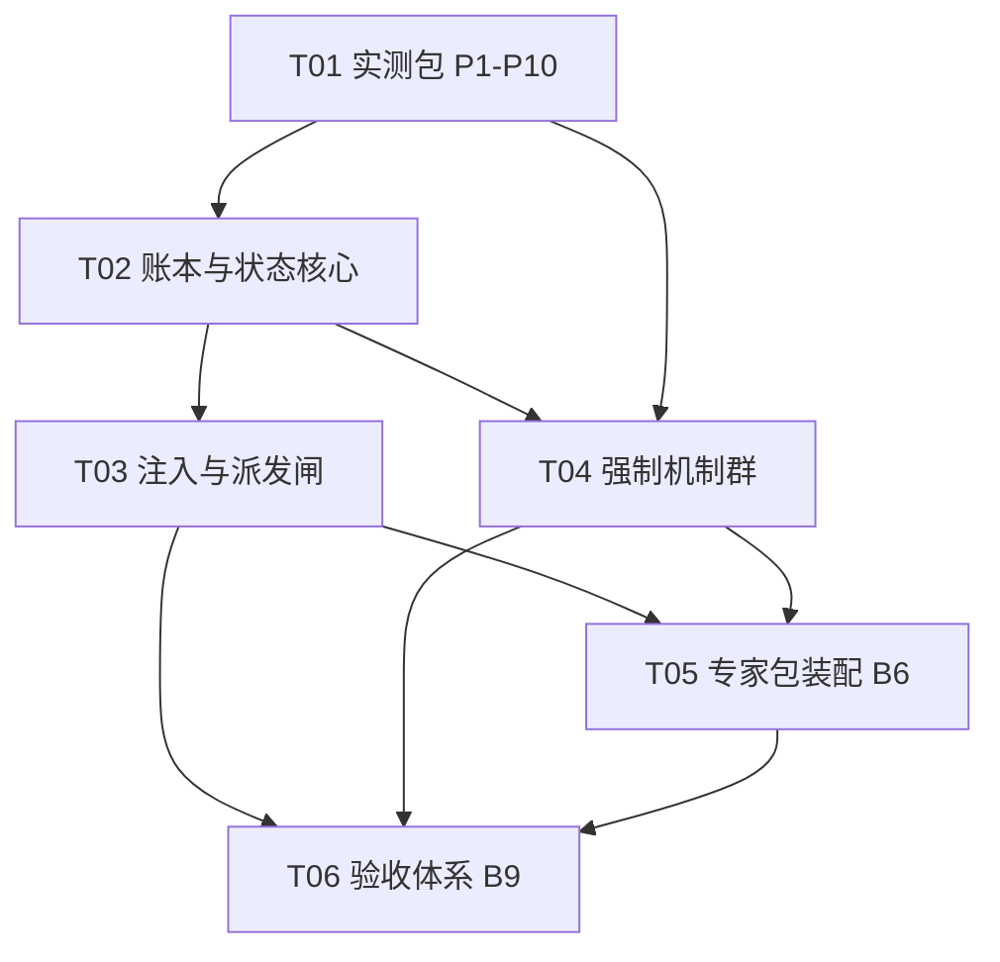

# SWB 分票包总览 v1（多席位协作系统·基线化后重立·架构席起草）

- ANCHOR＝**d01bdaf**（TKT36 再锚定开工 `git rev-parse --short HEAD` 实测，工作仓 `D:\multi-agent-collab-devkits`，main）。
- 设计真源＝`.collab/refs/external/SWB-交接件v2.8-产品设计与架构设计-2026-11-02.md`（292 物理行·纯 LF·V11 行号前缀＝登记件贴文正文行号（V11 n＝物理 n−27）；票面引用一律 V11，v2.4/v2.6/v2.7 登记件转过程证据不再引用）。现行基线＝v2.8 三方收口（PM-R10 `cd5d959`＋QA-R10 `5e30e50`）。开工前验读数（MERGE-V11 回执三值复现）：全文贴文正文段（物理 L28–292·265 行）sha256＝`b27c14aa164c304071bc353a114e75a333d87942d37f61fa7d8c159c9bd97403` ✅；产品本体 V11 L26–80（文件 L53–107·55 行）sha256＝`20a96da51abdf698b749c9422dde42a64bb46f5ef756c5c686a867fe7b78a59b` ✅；架构本体 V11 L81–253（文件 L108–280·173 行）sha256＝`66aab9217e64501507f389c28bcf0b53e356dae7b7f441ec4cab8a6da5079c82` ✅（复现口径＝python 段切 LF join 无尾换行）。
- 来历：两基线 v2.8 三方收口成立（产品席 PM-R10 完全认可＋QA 席 QA-R10 完全认可＋生成方落定·MERGE-V11 正式登记回执 `3fb8c47`）。旧分票包 v1.0–v1.3 作废；本包＝按架构 §18 消费面声明（V11 L233）重立，v1.2 起随 v2.7 基线、v1.4 起随 v2.8 基线。分票＝架构席职责（决策者 2026-11-01 裁定，同 FUXI 案先例「票面由架构席起草，主理人只路由派工」）。
- 本包纪律声明：不引入交接件外新机制主张；全部票面引用可指认 V11 行号或 §号；[未验证:P槽] 条款一律未作任何票面闸前提（§10 规则镜像），相关处置全部单列候裁。

## 一、票清单（总数＝6）

| 票号 | 文件名 | 一句话标的 | 闭集件数（申报） |
|---|---|---|---|
| T01 | 2026-11-01-SWB-T01-platform-capability-probes-p1-p10.md | P1–P10 平台能力实测落盘（实测清单承接） | 13 |
| T02 | 2026-11-01-SWB-T02-ledger-state-lease-core.md | B0 账本＋B1 誊录＋B2 状态机/租约签发（租约段实例化）＋补登演示＋转正代写 | 11 |
| T03 | 2026-11-01-SWB-T03-injection-dispatch-gate.md | B3 注入构造/串行闸＋B4 决策包（注入面＋串行/派发承接） | 7 |
| T04 | 2026-11-01-SWB-T04-enforcement-hooks-b5-b7-b8-b10-b11.md | B5 写侧校验/提交审计＋B7 签名＋B8 重放＋B10 停刀＋B11 记忆中立化（写侧校验承接） | 10 |
| T05 | 2026-11-01-SWB-T05-expert-pack-assembly-b6.md | 专家包装配＝B6 职能并入票：席位卡装填＋§8 装配表＋变更通道路由（席位卡装填＋变更通道承接） | 13 |
| T06 | 2026-11-01-SWB-T06-acceptance-system-b9.md | 验收体系＝B9 职能并入票：验收双臂＋§13 触发判据成值＋六条演练（验收双臂＋触发判据承接） | 11 |

闭集件总数（申报）＝13+11+7+10+13+11＝**65**。

## 二、消费面声明十项 ↔ 票号映射表（行数＝10·审计对照基准）

| # | 消费面声明项（V11 L233 逐字·含⑩） | 主承接票 | 次级承接 |
|---|---|---|---|
| 1 | 租约段实例化←表2-1 | T02（seat-permissions.json＋lease-issuer.py） | — |
| 2 | 写侧校验规则←表2-1不可写列＋提交审计 | T04（write-guard.py＋commit-audit.py＋deny_globs 消费） | T02（deny_globs 数据源埋设） |
| 3 | 席位卡装填←§5/§7 | T05（五卡＋§8 装配表逐行） | — |
| 4 | 注入面←表2-3 | T03（dispatch-spec.json 机械定义） | — |
| 5 | 串行/派发←表2-2/§4 | T03（serial-gate.py＋Agent ID 互验） | T06（drill-02 演练核验） |
| 6 | 实测清单←§10 | T01（P1–P10 逐号脚本） | — |
| 7 | 验收双臂←§16＋产品设计§4 | T06（三段式 CI 臂＋等效性抽检模板臂＋count-assert） | T05（无裸纪律装填面） |
| 8 | 变更通道←§12 | T05（lead 路由判定表五通道行） | T02（ticket-types.json 票型七类同源） |
| 9 | 触发判据←§13 | T06（thresholds.json＋metrics-gate.py） | T03（呈报触发源六码枚举） |
| 10 | 缺陷定级←表2-2（P0/P1＝QA 双复核＋人类终裁）〔⑩·V11 L233〕 | T02（state-transition.py 定级确认前置签收字段） | T03（decision-pack 呈报面含定级） |

## 三、§9 十构件（B0–B11·缺 B6/B9）↔ 票号映射表（表体行数＝12＝B0–B11 编号全覆盖·实构件 10＋空缺编号 2 行＝显式并入声明·审计对照基准）

| 构件 | 施工票 | 形态 |
|---|---|---|
| B0 账本 | T02 | 直接（ledger-init.sh） |
| B1 誊录登记 | T02 | 直接（intake-register.py） |
| B2 状态机＋租约签发 | T02 | 直接（state-transition.py＋lease-issuer.py） |
| B3 注入构造＋串行闸 | T03 | 直接（dispatch-builder.py＋serial-gate.py） |
| B4 决策包装配 | T03 | 直接（decision-pack.py） |
| B5 写侧校验与提交审计 | T04 | 直接（write-guard/commit-audit/liveness-selfcheck） |
| B6 装配施工票 | T05 | **显式并入声明**（§9 编号空缺刻意·T05 票面背景节具名） |
| B7 签名 | T04 | 直接（sign-verify.py·fail-closed 无降级） |
| B8 影子重放 | T04 | 直接（shadow-replay.py） |
| B9 验收施工票 | T06 | **显式并入声明**（§9 编号空缺刻意·T06 票面背景节具名） |
| B10 停刀 | T04 | 直接（freeze-unfreeze.py） |
| B11 记忆中立化 | T04 | 直接（memory-neutralize.py） |

## 四、产品 §4 违纪模式闭集表（16 行）拦截面 ↔ 票号映射表（行数＝16·审计对照基准）

| 行 | 违纪模式（V11 L51–66 逐行） | 锚点（设计原载） | 拦截面承接票 |
|---|---|---|---|
| 1 | 流程状态存放于账本之外 | U6＋B11＋B1 | T02（B1）＋T04（B11） |
| 2 | 越租约路径写入 | U2＋B5 deny | T04 |
| 3 | 上游席位代写下游产出 | 红线②＋U4＋G4 | T05（卡纪律行＋lead 卡红线摘要） |
| 4 | 跳过环节或签字集合缺一即通过 | 表2-3＋B3 串行闸（维护·轻签点＝合法签收形态（v2.8 表2-3 表注），不构成跳过环节） | T03（签字集合校验＋serial-gate）＋T02（state-transition 缺一拒迁） |
| 5 | 状态变更绕过脚本直改账本 | U5＋B2 日志互验 | T02（state-transition 唯一入口） |
| 6 | 检索自救替代注入自足 | U7＋P3[未验证]＋G5 | T04（B11 读侧出面·不声明能力面保证） |
| 7 | 无票提交/amend/rebase | B5 提交审计＋日终对账 | T04（commit-audit）＋T02（reconcile-daily） |
| 8 | 裸纪律入卡 | "无裸纪律"验收（§7） | T05（装面带标注）＋T06（count-assert 模式2） |
| 9 | 未验证能力被闸引为前提 | §10 规则＋四态标注 | T01（读数先行）＋全包票面纪律（总览声明节） |
| 10 | 计数/数字声明失实（含完备性断言失实） | 制度④计数即断言＋制度⑥完备即断言 | T06（count-assert 模式1/3） |
| 11 | 过程件被用作引用目标 | 制度②过程引用只可消除 | T04（shadow-replay 引用扫描＋memory-neutralize 引用扫描） |
| 12 | 生成方自判合格性 | 制度③状态申报制 | T06（结论权归 QA/CI 面·票面禁自判条款） |
| 13 | 降级态无人承接 | §14 承接表具名 | T06（抽检记录面）＋T01（QA 复核栏）＋T04（退路承接注记） |
| 14 | 停刀延迟超阈 | B10＋deny−freeze≤60s | T04（freeze 自计时）＋T06（成值 60 入 thresholds） |
| 15 | 派发身份不符/注入包超集/串行被破 | Agent ID 互验＋B3 白名单＋串行闸 | T03 |
| 16 | 审查注入面自选/灰度现场裁量 | dispatch-spec 机械定义＋B4 机械门禁 | T03（decision-pack 灰度门禁） |

## 五、票间依赖 DAG 与串行序

- 严格串行链：T01→T02→（T03/T04）→T05→T06。
- 逻辑可并行对：**T03 ∥ T04**（互不消费对方闭集文件；T03 只依赖 T02 数据源，T04 依赖 T01+T02）。
- 派工运行态＝架构表2-2（V11 L117）串行执行纪律：一票一新鲜实例、票间串行、一票活跃；**在 B3 串行闸（T03 产物）自身上线之前，票间串行由人类侧派工纪律保证**（主理人只路由派工）——此为时序自举注记，非新机制。
- 每票 commit 单独笔，`collab:` 前缀只含本票闭集件。

## 六、候裁点清单（单列·不自行拍·行数＝7）

| # | 候裁点 | 所在票 | 设计依据 |
|---|---|---|---|
| Q-01 | **已裁**＝`deliverables/experts/baigong-software-team/`（皮总 2026-11-01 ㊿·出处＝`.collab/decisions/2026-11-01-皮总拍板.md`） | T05 | §8 装配表相对路径无仓根规定→㊿（`.collab/decisions/2026-11-01-皮总拍板.md`） |
| Q-02 | P7 读数阴性→B0 退路三重保证中异地镜像承载细节 | T02 | §9 B0 退路＋§11 承载者＝人类侧 |
| Q-03 | `.mcp.json` 三 server 装配与否随 P8 求证（P8＝问句无预设）；P8 未出前不装配 | T05 | §8 行6 [未验证:P8] |
| Q-04 | P4 运行时阴性→SubagentStart 状态文件退路启用与否（人类拍板启用） | T04 | §9 B5 退路逐字 |
| Q-05 | P6 读数阴性→B10 退路「逐席显式 deny 列表」启用与否 | T04 | §9 B10 退路逐字 |
| Q-06 | disallowedTools 装填条件＝P3 实测 pass；未过缺省不装配 | T05 | §8 行3 [未验证:P3] |
| Q-07 | **已裁**＝选项 A：采纳 v2.8 表2-1 表注三条款为正式口径（路径锚定 V11 L105／判据真源双层双址 V11 L106／枚举款六类 V11 L107·**测试实体跟随项目**；皮总 2026-11-02 ㊼·出处＝`.collab/decisions/2026-11-02-皮总拍板.md`） | T02 | v2.8 表2-1＋表注三条款（V11 L95–107） |

## 七、计数即断言（制度④·自数＋交叉验）

- 申报（终态）：票总数＝6；各票闭集件数＝13/11/7/10/13/11；闭集总件数＝65；四映射表行数＝10＋12＋16＋7＝45（消费面表 10 行＝九项＋⑩缺陷定级；构件表 12 行＝B0–B11 编号全覆盖，实构件 10＋并入声明 2；候裁表 7 行＝Q-01…Q-07）。
- 完工实测读数（落盘后本机实测，附于回执；计数口径＝occurrence `grep -o … | wc -l`，非 `grep -c` 行数口径）：
  1. 票文件数：`ls .collab/tickets/2026-11-01-SWB-T*.md | wc -l` ＝6；
  2. 各票锚行下条目行计数：对每票 `- 声明闭集：` 锚行后连续裸 `- ` 路径行计数＝13/11/7/10/13/11（与票面申报数逐一相等）；
  3. 总览映射表行数：消费面表体行数＝10、构件表体行数＝12（B0–B11 编号全覆盖）、违纪表体行数＝16、候裁表体行数＝7（与反查基准一致，无空项）；
  4. 文件名 kebab 正则：`ls .collab/tickets/2026-11-01-SWB-*.md | grep -cE '^\.collab/tickets/2026-11-01-SWB-(T[0-9]{2}-)?[a-z0-9]+(-[a-z0-9]+)*\.md$'` ＝7（6 票＋1 总览；全部通过，零命中大写/下划线/非 ASCII）。
- 交叉验第二实现＝T06 交付后由其 count-assert.py 模式1/3 重跑同一断言（本包阶段以 shell 计数为第一实现）。

## 八、禁动面（全包统一·各票票面另列个体面）

- 两基线登记件本体（v2.8 件 V11 文件全域；v2.4/v2.6/v2.7 过程证据件同零触碰）零触碰；`.collab/` 过程域仅各票回执文件一处新增加入（回执落 `.collab/receipts/`），其余零触碰；`docs/`、既有交付面（deliverables/、tools/、workbuddy/、README、.gitignore）零触碰；各票彼此声明闭集文件互不可写。
- 本总览与六票本身＝本任务唯一新增面（`.collab/tickets/` 内 7 件新文件）。
