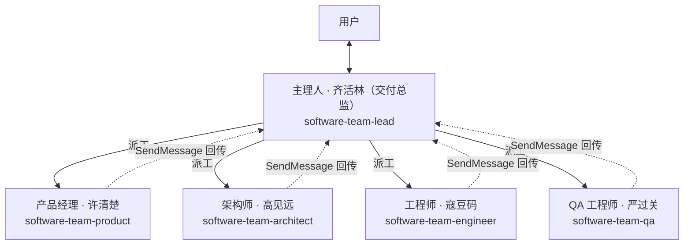

# 百工软件团队 · 架构设计文档

> 对象：`baigong-software-team` 专家团 bundle（五席位 + 编排技能包 + 装配机制 + 仓级门禁）。
> 现行版本态：bundle 0.1.10 ／ software-orchestration 1.1.0。
> 本文描述被设计对象的结构与机理；包内文件一律包内相对路径，仓级支撑工具只提名不写路径。

---

## 一 总体结构图

### 1.1 编制图（消息必经中转 · 成员结论为准 · 禁直连）



铁律三条（真源在 lead 席位 MD「团队协作机制（铁律）」节）：

1. **消息必经中转**：所有跨成员信息流必须经主理人中转，成员不得互相直连；主理人负责汇总并把上游产出转交下游（PRD→架构师、任务列表→工程师）。
2. **成员结论为准**：PRD／架构设计／任务列表／代码实现／测试结果五类专业产出必须由对应席位输出后主理人才采信，主理人只做编排与汇编，严禁代写。
3. **团队创建唯一入口**：TeamCreate 只能由主理人执行，严禁委派成员建团；调度成员时以席位 Agent ID 同时传 `name` 与 `subagent_type`。

### 1.2 分层视图（身份面 · 流程面 · 装配面 · 治理面）

```
┌─ 交付包（bundle 面，用户可见注册态）─────────────────────┐
│  agents/            五席位 MD（身份 + 守则 + 路由指针）      │
│  skills/            software-orchestration（流程域本体）     │
│                     external-advisor-collab（装配组件）      │
│                     deep-research（装配组件）                │
│  avatars/           六件头像（五席位 + team）                │
│  .codebuddy-plugin/plugin.json   注册清单（团队声明）        │
│  bundle.lock        组件锁 + bundle 版本行                   │
│  README.md          出身 / 版本账 / 维护规则                 │
└──────────────────────────────────────────────────────┘
        ▲ 装配（bundle.lock 驱动，产物落仓外 -build 预览面）
        │
┌─ 仓级治理面（不随包分发，只提名）────────────────────────┐
│  run-gates 门禁入口 · 常驻机检四族（见 §五）                 │
└──────────────────────────────────────────────────────┘
```

设计要点：**仓面＝真源，装配面＝派生产物**。交付包不是手写的第二份，而是由装配器按 `bundle.lock` 从仓面真源装配生成；注册态 bundle 内的装配组件（`skills/external-advisor-collab`、`skills/deep-research`）在部署包内自包含命中，不依赖仓外路径。

---

## 二 席位设计

### 2.1 席位 MD 的三层结构

每个席位 MD 遵循同一分层模板（token 预算线：每席 ≤2,500 红线、≤2,350 目标）：

| 层 | 内容 | 位置 | 席位分布 |
|---|---|---|---|
| **身份层** | frontmatter（name/description）＋ Core Identity（姓名/角色/目标/约束）＋ 职责与产出规格 | 各席位 MD 前段 | 五席皆有 |
| **守则层** | 「写权边界」自指短声明 ＋「交接与收口声明」自指短声明（＋ lead 独有的「团队协作机制（铁律）」节） | 各席位 MD 后段 | 五席皆有（铁律仅 lead） |
| **路由层** | 工作流路由判定表 ＋「⛓ 必读」下沉细则路由表 ＋ 外部顾问讨论会兼任节 | lead MD 独有 | 仅 lead |

四成员席位共享同一「团队协作（回传机制）」节：经 SendMessage 接收主理人任务 → 独立产出 → SendMessage 完整回传主理人 → 缺输入向主理人索取 → 收 shutdown_request 后收尾。

### 2.2 五席一览

| 席位 | 文件 | 身份层职责 | 守则层要点 |
|---|---|---|---|
| 主理人 齐活林 | `agents/software-team-lead.md` | SOP 编排、工作流档位判定、成员调度与中转汇编 | 写权＝过程域；派工合规硬门；拒写权自指句；收口自检＋派工件干净度自指句 |
| 产品经理 许清楚 | `agents/software-team-product.md` | PRD（简单/完整两档）＋市场调研报告 | 写权＝过程域，交付面拒写；收口五件套自指句 |
| 架构师 高见远 | `agents/software-team-architect.md` | 系统设计＋任务分解合体产出（九节：方案/文件表/类图/时序图/任务表/包/共享知识/依赖图） | 同上 |
| 工程师 寇豆码 | `agents/software-team-engineer.md` | 批量实现代码＋全局一致性审查（IS_PASS）＋增量开发最小变更 | **交付面唯一写权席**；写入集＝票面声明闭集；完工回执逐项列写入集 |
| QA 工程师 严过关 | `agents/software-team-qa.md` | 测试编写＋运行＋智能路由（Engineer/QA/NoOne）＋≤2 轮硬限 | 写权＝过程域；收口判定前逐件核对回执清单与交付面纯净性 |

### 2.3 写权闭集模型（两域 + 唯一写权 + 双闸）

```
写权域划分（以过程域目录为界）：
  过程域（.collab/ 及其子目录）……… 五席皆可写：设计稿/分析/判词/回执/票面等过程件
  交付面（过程域以外一切）…………… 仅工程师席可写：代码、条款、交付文档
```

- **唯一写权**：工程师席是交付面唯一有写权限的席位；其写入集＝任务票声明的文件闭集，越集即违例；完工回执须逐项列出写入集并与提交实写面全等对账。
- **第一道闸（派工侧）**：主理人拟票/派工时，凡含代码性质或交付面写入的任务只派工程师席——派工合规硬门对派工侧生效（lead 的 ⛓ 路由表含通用开发纪律卷加载行，触发条件＝拟票/派工含代码性质或交付面写入）。
- **第二道闸（席位侧拒写权）**：非工程席（含主理人自己）受命向交付面写入时，有权且应当**拒绝写入＋报主理人改派工程师席**；拒绝不构成违例，执行才构成违例。该声明逐字内嵌于主理人／产品／架构／QA 四席 MD 的「写权边界」节，形成席位自带的第二道闸。
- **细则真源分工**：席位 MD 只载自指短声明（含「本席」自指串＋真源卷名指针），条文本体在技能包纪律卷——不复写，防第二真源。

---

## 三 技能包架构 · software-orchestration

### 3.1 包形态

`skills/software-orchestration/`＝主理人流程域技能包：SKILL.md（触发词＋索引，不承载细则，version 1.1.0）＋ `skills/software-orchestration/references/` 分件（细则本体）。当前盘面为 SKILL.md ＋ references **十卷**（SKILL.md 索引表恰十行，与目录一一对应）。

设计动机：lead 席位 MD 是每次会话全付的 cost center，references 是按档触发才付的 asset。lead MD 结构性瘦身后只留身份、铁律、路由判定与 ⛓ 指针；执行程序本体逐字下沉分件，判定走某档后第一件事读对应分件（确定性通道，不依赖语义匹配）。

### 3.2 references 分卷地图（职责 / 触发 / lead 路由对应）

| 卷 | 职责 | 触发条件 | 对应 lead「⛓ 必读」路由行 |
|---|---|---|---|
| `skills/software-orchestration/references/quick-mode.md` | ⚡ 快速模式全节（≤10 文件小需求·跳过 PRD/架构·工程师直写＋QA 验证） | 判定走快速模式 | 有 |
| `skills/software-orchestration/references/bugfix-path.md` | 🔧 BugFix 快捷路径全节（明确 Bug 三步流程） | 判定走 BugFix | 有 |
| `skills/software-orchestration/references/standard-sop.md` | 🏗️ 标准 SOP 全节（五席逐步派单·IS_PASS 与智能路由流转） | 判定走标准 SOP | 有 |
| `skills/software-orchestration/references/incremental-dev.md` | 增量开发全节（变更需求下四席动作序·最小变更） | 已有项目上的变更需求 | 有 |
| `skills/software-orchestration/references/partial-workflows.md` | 部分工作流全节（六子模式枚举：仅 PRD/架构评审/代码实现/仅测试/市场调研等） | 判定走部分工作流 | 有 |
| `skills/software-orchestration/references/collab-rules.md` | 协作规则 §1,2,4-7（顺序流转/信息传递/反馈回路/语言/文档化/结构化；§3 质量关卡留 lead MD 未沉） | 任意工作流推进中 | 有 |
| `skills/software-orchestration/references/delivery-summary.md` | 交付总结四段式＋可选落盘报告（默认不落盘） | 工作流收尾汇编交付前 | 有 |
| `skills/software-orchestration/references/deploy-gate.md` | 部署动作硬门闭集（装配/注册/覆盖缓存＝独立票＋获批）＋四段部署流程 | 任何环节出现部署类动作字样 | **无路由行**——经 SKILL.md description 触发词（装配、注册、部署、覆盖缓存、硬门、预览、人类闸）命中 |
| `skills/software-orchestration/references/dev-discipline.md` | 通用开发纪律：写权闭集／代码纯度／工程师完工回执／QA 纯净职责（四闸一体） | 拟票派工含代码性质或交付面写入；回执与纯净判定前 | 有 |
| `skills/software-orchestration/references/handoff-discipline.md` | 交接与协作纪律：交接件规格／三正面判据／append-only／收口自检五件套／验收读数分账／报告三律／派工件干净度／机制断言须附实测／席位声明形式约束 | 交接件、收口声明、报告分级、席位声明形式 | 有 |

### 3.3 两纪律卷分工与互指

分工句（两卷卷尾互指，逐字口径）：

- dev-discipline §五：「本卷与 handoff-discipline 互指：那边＝交接/收口/报告/隔离律真源，这边＝写权/纯度/回执/判定四闸真源。」
- handoff-discipline §十一：「那边＝写权/纯度/回执/判定四闸，这边＝交接/收口/报告/隔离。与 deploy-gate、collab-rules 各自域内自立，冲突时以各自真源域为准。」

即：同一纪律只在一卷成文，另一卷只放指针。deploy-gate 与两纪律卷也互指——部署动作义务在 deploy-gate，写入内容本身在 dev-discipline。

### 3.4 真源唯一纪律

- lead MD 只留身份/铁律/路由判定＋⛓ 硬读指针；细则在 references 单点成文（「改一处漏一处」是防的对象）。
- 席位级权限声明真源在各席位 MD「写权边界」节；纪律条文真源在 dev-discipline；交接/收口条文真源在 handoff-discipline；机检判据参数真源在审计器侧（技能卷只指不搬）。
- 逐字下沉件受逐字门保护：lead 原 §节逐字照录入分件，对账基准＝「市场版 vs 附录逐字件＋留块合集」的重构态。

---

## 四 装配与版本架构

### 4.1 bundle.lock 组件模型

`bundle.lock` 是装配机的输入，两组成：

**bundle 本体行**：name＋version（semver）＋源仓路径；版本行与 `.codebuddy-plugin/plugin.json` 的 `version` 同源。

**components 数组**（每项＝组件锁），现行两组件：

| 组件 | 真源位置（仓相对） | 锁引用 | 装配目标（包内相对） | 性质 |
|---|---|---|---|---|
| `external-advisor-collab` | 同仓技能真源目录（`repo: "."`＝仓根解析） | 不可变 tag `external-advisor-collab@v1.1.1` | `skills/external-advisor-collab` | 同仓组件 |
| `deep-research` | 跨仓技能仓目录（`repo: "../multi-agent-collab-skills"`） | 不可变 tag `deep-research@v1.0.2` | `skills/deep-research` | 跨仓组件（fork 登记制） |

关键约定（lock 内 conventions 节成文）：

1. **锁不可变引用**：组件一律锁 tag 或 commit，禁 HEAD/分支名；tag 命名 `<组件名>@vX.Y.Z`。消费者侧改锁＝换 ref 指向新不可变 tag，旧 tag 保留。
2. **roottag 对齐门禁闭集**：组件真源根标签∈{experts, skills, softdev}，与真源唯一扫描的门禁闭集对齐。
3. **target 对齐注册清单**：装配目标＝bundle 内相对路径，与 plugin.json `skills[]` 的引用逐项对齐（注册三技能＝software-orchestration＋两装配组件）。
4. **产物不入库**：装配产物不入任何仓版本库；缺省输出＝与 bundle 源仓同级的 `<仓名>-build/<bundle 名>` 预览面。

### 4.2 仓面真源 vs 装配面派生

- 分仓＝维护/分发维度；部署到宿主＝把相关 skills **装配**进专家团。组件真源留在各自真源池不出池。
- 装配面是**派生产物非第二真源**：仓外 `-build` 预览面只准从仓面生成，人不手改；装配器取源时排除编译缓存件（`__pycache__/`、`*.pyc`）。
- 装配环节的价值：lead 讨论会兼任节「加载技能 external-advisor-collab」自此命中**包内装配件**——部署态自包含，运行不再挂仓外指针。

### 4.3 四段部署流程（装配 → 预览 → 人类闸 → 部署）

部署＝标准工序但形态＝四段闸口链，每段须上游收口才进，禁跳段：

```
① 装配（QA 终审绿＋独立部署票） → ② 预览（注册进本地市场 + 会话标记挂预览卡）
→ ③ 人类闸（人类真实验证并明示结论，代理不可代跑） → ④ 部署（明示通过＋明示批准含路径）
```

配套硬门（deploy-gate 卷成文）：装配产物生成／注册进部署面／覆盖运行中插件缓存＝闭集部署任务，必须独立部署票＋用户明示批准两条件缺一不可；票面或交接件混入此类字样而无批准记录＝执行席停手登记、对账席红项。获批范围按段界定：批到②止的票不得顺手动④。

### 4.4 版本账纪律

1. **同源镜像每变必 bump**：plugin.json `version` 与 bundle.lock bundle 版本行同源，任一批次改动两行必同改——bump 兼具功能语义（semver 分级）与工程抓手（逼宿主按包版本刷新运行缓存，规避同版本号免刷新漂移）。
2. **组件版本与 SKILL.md 同源**：组件锁 tag 的版本号＝该组件 SKILL.md 内 `version:` 值（如 external-advisor-collab 锁 v1.1.1＝其 SKILL.md 1.1.1）；升级组件＝真源升版打新 tag→lock 换 ref→bundle 双行 bump。
3. **版本账留档**：bundle README 维护逐版版本账（现行为百工 0.1.x 段；旧血脉各账行转前血脉沿革，留档不续账）。
4. **出身账**：fork 基线＝市场包 `software-company` v1.1.0 照录；fork 后改动清单逐条登记；上游不自动追，需要时人工 diff 对账。

---

## 五 质量门禁架构

本节只述机制名与判据语义，不写仓内工具路径（工具带只提名）。

### 5.1 席位声明短声明形式约束（产品化表述）

席位 MD 与纪律卷的分工由一条**形式约束**闭环治理：通用卷载判定尺、席位 MD 载自指短声明，声明不复写条文。可机检口径五条：

1. 每席声明块单次整合增量 ≤8 行（diff 行数可判；总量 ≥15 行时回裁）；
2. 每条声明 ≤1 行（无软换行续行）；
3. 与通用卷条文**最长连续重合 ≥12 CJK 判复写**（沿用真源唯一扫描同一阈值与扫描面，不新设双阈值）；引用卷内术语以引号括词条形式出现按提及处理，但括注段连续 ≤10 CJK 才按提及处理，超限仍计连续重合；
4. 声明句须含「本席」自指串＋真源卷名（dev-discipline／handoff-discipline／deploy-gate／collab-rules 四选一），grep 双条件可判；
5. 机检三前置：声明块定界符约定、通用卷基线抽取约定（句级单元比对）、扫描面调用形态（席位声明块 × 纪律卷条文单元定向比对）。

效果读数（版本账所载）：席位声明缺项经补缺与措辞收敛批后，声明声明缺项从 5 收敛至 0。

### 5.2 常驻机检四族（清单提名）

| 族 | 检查器/机制名（只提名） | 判据语义 |
|---|---|---|
| 真源唯一扫描 | check-source-of-truth | 同一条文/细则不得在真源面与消费面双处成文（连续重合阈值判复写）；兼挂席位声明 C 段 |
| 席位声明机检 | 同上扩 C 段（spec_id：MC-SEAT-DECL） | §5.1 五条形式约束的 grep/diff 可判化 |
| 指针闭环 | 审计器文档域 D6-3／D6-4 | 从交付包根解析不可达的指针即违例（包内相对互引放行）；`sources/` 子包＝唯一允许进交付物的自包含料源，其内部指针同样不得出包 |
| 声明闭集对账 | check-ticket-reconcile（spec_id：OA-D6-5） | commit↔回执↔票面声明三段对账基面分段（git name-only × 交付面 listing），回执清单与实写面全等，越集即违例 |

### 5.3 advisory / block 两态

门禁检查分两态挂线：**advisory**（首挂观察态，出读数不拦停，读数对账不误报漂移后转正）与 **block/GATE**（违例即拦，BLOCK 级新命中须归零方可收口）。挂线策略＝新检查器先 advisory 攒基线（如 MC-SEAT-DECL、OA-D6-5 首挂均 advisory），基线稳定后按项目口径决定转正；门禁入口由 run-gates 统一编排，缺省跑含全部在册检查器（存量不适用项按 SKIP 分账，不计违例）。

---

## 六 关键设计决策（择要五条）

1. **SOP 驱动而非自由协作**：代码＝SOP(团队)——档位判定表先行（快速/BugFix/标准/部分四档），宁选快速不选过重；流程可预期才可审计。
2. **流程细则下沉 references、席位 MD 不复述**：席位 MD 是每会话全付的成本面，细则是按档触发才付的资产面；下沉＋⛓ 硬读指针把成本从「全付」移到「按付」，同时消灭「改一处漏一处」的第二真源。
3. **fork 自维护不追上游**：市场包 fork 后以本地版本账＋改动清单为纲，上游不自动追、需要时人工 diff 对账一次——换取本地演进不受上游节奏约束。
4. **引入装配环节**：从「真源直拷」改「bundle.lock 驱动装配」——组件锁不可变 tag、装配面派生不入库，既保住真源唯一，又让部署态自包含（技能加载命中包内件）。
5. **身份切割、版本重起算**：新团与旧血脉间做身份切割，版本号弃续账改从 0.1.0 起算（未达正式可用资产完备度就不挂正式版号）——版本语义只对内解释自身成熟度，不背历史包袱。

---

## 七 演进边界（改动影响面与版本步语义）

| 层 | 改动对象 | 影响面 | 版本步语义（现行口径） |
|---|---|---|---|
| **席位层** | `agents/*.md` 五席：身份、守则短声明、⛓ 路由行 | 每席 token 预算线（≤2,500 红线）；声明形式约束机检读数；席位间引用需同步 | 席位定义行为变化→至少 **patch**；席位增删/id 更名＝结构性/破坏性变更→**major**（id 更名按身份切割另议） |
| **技能层** | `skills/software-orchestration/`：SKILL.md 索引/触发词、references 分卷条文 | 组件自身版本独立 bump（SKILL.md `version:` 为准）；lead ⛓ 路由行与索引行须同批对齐；互指卷只放指针不搬条文 | 语义条款增改→**minor**；引用形态清理/措辞收敛（语义零动）→**patch**；卷拆分合并/索引结构变化→至少 **minor** |
| **装配层** | `bundle.lock` 组件行（增删组件、换 ref tag）、`.codebuddy-plugin/plugin.json` 注册清单 | 注册面 `skills[]`/`agents[]` 对齐；装配产物重出＋预览；宿主缓存按 bundle 版本刷新 | 分发结构变化（组件增删、注册清单变化、包 id 更名）→**minor 起步**（id 更名现行口径记 **major**覆前例）；组件内容升版→bundle 双行至少 **patch** 跟 bump |

跨层联动铁律（任一批次同时触碰多文件时）：

1. **每变必 bump·同源镜像**：动了 bundle 面任何文件，plugin.json `version` 与 bundle.lock bundle 版本行两值同改（纪律①）；组件升版则组件 tag、SKILL.md version、lock ref 三处同源。
2. **装配面不可手改**：改一律回到仓面真源，重装配生成预览面；进部署面走四段链人类闸。
3. **版本语义宁保守勿激进**：拿不准时按「是否改变消费方可见行为」分级——改变→minor，语义零动的形态清理→patch，破坏既有注册/引用契约→major。

---

